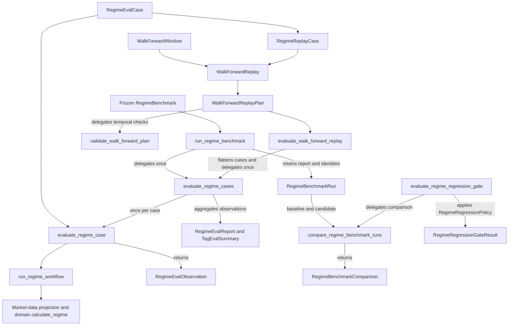

# Contracts and Compatibility Reference

This is the sole interface/invariant reference. [Spec](spec.md) owns product
requirements and [data-model](data-model.md) owns entity semantics. Implemented
Python types and generated schemas define exact field/signature spelling. Target
contracts below require technical design before implementation; they do not
introduce callable operations in the current build.

## Target interface boundary

Work and the dashboard use explicit typed queries and commands. Queries expose
configuration, frozen evidence, portfolio snapshots, role/decision status and
stored results. Commands require a valid lifecycle stage, expected version,
bounded validated payload and idempotency identity. Local services authorize
state changes, calculate risk and quantities, and record acceptance or a precise
rejection. Discovery/registration alone does not authorize a command.

The first interface design must cover start/resume/status, evidence access,
role/challenge submission, the one supplementary round, portfolio proposals,
local validation, simulated order processing, pause controls, evaluation and
as-of memory. Operation names, schemas, transport/authentication, numerical limits
and stage transitions are deliberately unfinalized until RQ-01–RQ-05. Reuse an
existing operation only if its semantics fit; never reinterpret a legacy
research publication as approval to execute a simulated order.

Each accepted decision binds policy, portfolio, evidence, role artifacts,
runtime provenance and simulator versions. Subsequent local mutation must reject
stale/conflicting inputs and duplicate effects. Validation failure cannot silently
repair a strategy into a new accepted trade. Simulation must reconcile every
quantity/cash effect; deterministic replay must reproduce accepted effects without
network/model calls or a current-policy reload.

## Current implementation profile

The remaining sections preserve the checked-in research/runtime/evaluation
contracts as of `d4915fb`, package `0.5.0.dev0`. They are effective for those
interfaces and historical artifacts until explicitly migrated. Fixed skill/tool
counts, old technical setups and research-only plan states describe this profile;
they are not global limits on the approved trading-agent target.

### Current authority hierarchy

1. Approved Product A specification, now consolidated in [spec](spec.md) and this
   compatibility profile, defines current research scope and obligations.
2. Python typed domain models, policies, calculations and validators own numbers,
   states, units and deterministic gates.
3. Generated JSON Schemas derive serialized contracts from those models.
4. [workflow-contract.yaml](../skills/premarket-research/references/workflow-contract.yaml)
   owns the current premarket order, handoffs, bounded repair and outcomes.
5. Each [SKILL.md](../skills/README.md) owns its bounded trigger, operations,
   resource loading and failure/output obligations.
6. Canonical synthesis prompt instructions shape a draft from frozen inputs.
7. Canonical report template owns deterministic Markdown presentation.
8. Immutable JSON run bundle owns the recorded truth and component versions for
   one frozen run.
9. Derived documentation, saved prompts and rendered Markdown guide readers.

This hierarchy does not rewrite history. A frozen bundle retains its original
evidence and component versions. Replay uses compatible versions or reports/fails
closed on drift according to the operation. Current documentation cannot change
a historical run.

### Current operation and source boundary

[operations.py](../src/finance_research_agent/application/operations.py) defines
eleven typed current operations. The three canonical skills have one adjacent
premarket manifest; there is no global registry, general workflow engine or
skill-local financial/provider script. These counts remain enforced for the
current build. The local MCP transport exposes typed services and no arbitrary
URL/path/shell/code-evaluation operation.

Operational composition enables Alpaca market data and the local exchange
calendar. Adapter class presence does not activate company, news, SEC or macro
sources. The current source-role gates leave dependent capabilities unavailable;
no new source or production model adapter is activated by this document. Current
research plans still require human review and have no execution capability.

### Strict values and numeric fidelity

Use closed enums, schema versions, strict validation, explicit units/windows,
canonical UTC timestamps and immutable nested containers. Reject extra fields,
naive time, nonfinite/invalid Decimal values and caller-mutable leakage. Hashes
must not depend on map insertion order, YAML formatting, ambient Decimal context
or caller mutation. Persist actual validated configuration values and versions,
not merely source paths/hashes. Missing capital or risk limits remain unavailable.

The existing indicator formulas, precision/context behavior, unavailable reasons,
evidence IDs and public imports are compatibility requirements. Exact formulas
are in [indicators](../src/finance_research_agent/domain/indicators.py): SMA,
SMA slope, relative return, ATR percentage, realized volatility, percentile
rank/distributions and equal-weight basket return. Do not redefine these in
prompts, UI calculations or a new host adapter.

### Temporal provenance and source quality

Live observation/retrieval must not exceed the frozen evidence cutoff. Historical
offline retrieval may occur after a simulated decision, while request bounds,
source bounds and completed-session requirements still apply. Source event time
does not prove publication/revision availability. Future scheduled events can be
known before cutoff. Output timestamps cannot repair missing provenance.

`SourcePolicy.quality_source_roles` is a frozen unique tuple of roles with
market-data and calendar required. Adapter allowlisting is a separate concept.
Require exactly one valid matching health record per configured role; reject
missing, duplicated, mismatched and out-of-scope health. Never infer required
roles from the supplied health rows. Omitted roles yield `SOURCE_NOT_CONFIGURED`
and dependent unavailable capabilities, not invented success. Market/calendar
failure can be global; symbol-local failure stays scoped. Current missing macro
and official verification block dependent planning/sizing capabilities according
to [quality](../src/finance_research_agent/domain/quality.py).

FACT claims require relevant subject/time/field evidence; CALCULATION claims
must match versioned MetricResult values, units, periods and inputs; INFERENCE
must be grounded and calibrated; HYPOTHESIS includes support, counter-evidence,
invalidation and expiry. Citation existence is insufficient. Lower-authority
discovery cannot silently override regulator/company evidence; conflicts stay
visible. Feed/session/coverage limitations are explicit: IEX is not consolidated
market coverage. Store bounded permitted excerpts, not complete licensed articles.

### Configuration and run allocation

The five fixed policy files are validated as one configuration. Watchlist writes
use optimistic version checks and atomic validated replacement. The current
watchlist has CORE_MONITOR, SATELLITE_ELIGIBLE and RESEARCH_ONLY research roles
and a 30-item limit; it is not a record of holdings.

Application builds an immutable RunContextSeed; storage atomically allocates
date/revision identity and persists full context once. Scheduled duplicate first
revisions retain original inputs, manual next revisions are monotonic, and exact
staged resumes retain snapshots. Gaps/conflicts fail before mutation. The lower
allocator rejects published allocation; the preparation API can return an
existing immutable publication for an explicitly requested published revision.

Allocate with an unbound cutoff; bind it once at evidence freeze, never before
invocation. Invocation time is not an automatic evidence cutoff. Packet/staging/
publication writes reject unbound contexts. Later collection cannot modify a
frozen run. Source roles, actual prompt/resource bytes and component versions
come from trusted frozen configuration, not model-supplied overrides.

### Packet assembly and synthesis validation

Assemble stable evidence IDs, deterministic order and exact financial values.
Trim duplicate discovery excerpts first, then low-authority discovery excerpts,
then verbose non-factual text. Preserve warnings, conflicts, counter-evidence,
provenance, gates, exclusions, sizing intermediates, plan inputs and prior
observations. Record omissions; protected overflow fails closed.

The trusted preparation packet limit is 8,000,000 bytes. Artifact JSON permits
arrays up to 8,192; model/evidence JSON retains 128-element arrays/maps and
8,192-character strings. Large bar histories are chunked without losing bars or
evidence identity. Do not weaken model-input limits to accommodate storage.

Validate the structured ResearchBriefDraft against the stored packet: exact
numbers/units, evidence reachability and scope, claim support, status overclaims,
coverage disclosures and required limitations. Current behavior allows an initial
draft plus two repairs, at most three validations, all against the same frozen
packet. Invalid drafts cannot publish. Reduced/operational outputs are explicit
and cannot imply a full successful research result.

### Preparation, persistence and recovery

Preparation returns a full frozen packet or a self-published operational failure;
CONFIG_FROZEN alone is not a successful handoff. The low-level initializer
remains separate. Nonrunnable time windows do not generate research packets:
missed-window operational output/diagnostics follow the current calendar rules.
Immutable existing publication is returned idempotently. A frozen packet or
quality checkpoint resumes without fresh provider construction/evidence.

Prior research plans are selected and frozen before collection using bounded
immutable queries and completed-bar observations. Trusted prompt digest binds
actual canonical bytes before allocation; resume retains the original version.
The application has a shared trusted 15-minute preparation deadline; providers
and HTTP/DNS consume that budget. MCP callers cannot override it. DNS waiting is
bounded, with at most one unfinished resolver per client; an OS resolver worker
may finish later, but no HTTP request starts after the deadline.

Preserve lease/token ownership, serialized heartbeat/acquisition, per-date
allocation/create locking and per-run checkpoint sequence locking. Checkpoints
and published artifacts bind canonical hashes; corruption fails closed instead
of silently selecting older artifacts or recollecting evidence. Publish complete
JSON/Markdown atomically and update the formal index only on success. A staged
artifact or command acknowledgement is not publication. Publication retains its
original trusted receipt time. Post-allocation preparation failures produce
closed-code operational output when storage permits; storage/publication errors
remain redacted failures.

### Resource and component identity

Hash actual installed canonical resource bytes, including conditional declared
resources. Reject unsafe POSIX paths, traversal, duplicates, symlinks and missing
resources. Sort by UTF-8 logical path; hash each framed record as
`uint64_be(path_len) + path + uint64_be(content_len) + content` with SHA-256.
Prompt/template hashes remain separate from `skill_version`. Core, plugin, MCP,
schema, prompt, skill, policy and template versions retain distinct meanings.
Source-checkout fixtures inject explicit trusted synthetic versions. Installed
wheel/sdist resources must match their declared identity.

### Security boundary

Central HTTP adapters enforce HTTPS/host/path allowlists, public-address DNS
checks, redirect validation, safe ports and bounded content type, body size,
retries and deadline. Reject credential-bearing URLs, unsafe fragments and path
traversal, including repeated percent decoding to a fixed point and both slash
styles. Calendar adapters reject naive timestamps before conversion.

Credential lookup uses environment, then macOS Keychain, then ignored owner-only
dotenv. Runtime paths are confined; symlink escapes and caller-selected arbitrary
paths are rejected. External source text remains inert, and diagnostics must
redact raw provider exceptions, credentials and private paths. Default tests use
injected HTTP/DNS fakes and the offline network guard.

### Telemetry

Measure physical HTTP attempts including retries/redirects/failures and accepted
body bytes, not estimated wire traffic. Calendar I/O contributes no HTTP count.
Stages are RUN_PREPARATION, MARKET_COLLECTION, QUALITY_EVALUATION,
PACKET_ASSEMBLY, VALIDATION and PUBLICATION. Durations use monotonic elapsed time
floored to milliseconds; wall time remains separate from evidence cutoff.

External draft submission is not an observed model call: current synthesis
attempt count stays zero. Validation attempt count is persisted and capped at
three. Packet size is exact canonical bytes, zero before a packet exists. Cache
hits/misses remain zero without a response cache; instrument memoization does
not count. The 900,000 ms telemetry target records consumed/remaining budget
and may be exceeded; it is distinct from the actual preparation deadline.

Telemetry is checkpoint/hash-bound with serialized updates; failure checkpoints
retain completed measurements, while uncheckpointed crash work is not fabricated.
Published replay reuses stored measurements without clocks/network. Only bounded
IDs/counters are stored, with no secrets, raw errors, URLs or excerpts. Invalid
counters/hash drift fail closed. Telemetry does not determine business authority.

### Existing API retention

Retain supported consumers until a reviewed migration replaces them:
`domain.market.MarketSnapshot` (RegimeMarketSnapshot alias), the distinct canonical
`domain.models.MarketSnapshot`, exported `market_data.to_market_snapshot`, the
standalone regime workflow projection, `application.HistoricalBarsFetcher`,
`application.run_regime_research`,
`adapters.alpaca_historical.AlpacaHistoricalBarsClient`, `agent.AgentRuntime`,
and the `evals` entrypoint documented below. Current typed modules and
characterization tests define signatures. Future interface breaks are allowed
only with explicit consumer migration and historical-meaning preservation.

## Existing research methodology

The following formulas and legacy plan semantics are retained from the approved
research baseline. The new agent can use these tools without restricting every
investment thesis to their setup families. Their use as future portfolio gates
requires the new risk-policy design rather than an implicit copy.

## Market-Regime Model

Market regime is deterministic and uses five components:

| Component | Initial weight | Inputs |
|---|---:|---|
| `BROAD_TREND` | 30% | `SPY` and `QQQ` trend structure |
| `PARTICIPATION` | 25% | Eleven-sector trend breadth |
| `LEADERSHIP` | 20% | Growth, small-cap, cyclical, and defensive relative strength |
| `VOLATILITY_STRESS` | 15% | SPY realized volatility, ATR percentage, and optional official volatility data |
| `CREDIT_CROSS_ASSET` | 10% | Credit, Treasury, dollar, gold, and oil proxies |

Each component returns:

```text
+1  POSITIVE
 0  MIXED
-1  NEGATIVE
NA  UNAVAILABLE
```

The weighted result ranges from -100 to +100.

### Initial classification policy

```text
PERMISSIVE  score >= +35 and no critical stress flag
NEUTRAL     score from -34 through +34
DEFENSIVE   score <= -35 or a critical stress flag is active
UNKNOWN     broad trend is unavailable, or too many required components are unavailable or conflicting
```

The component rules and thresholds are versioned in `regime-policy.yaml`. The initial implementation uses completed daily bars and transparent trend, breadth, relative-strength, and volatility-percentile rules. It does not fit weights to the initial 20-day shadow sample.

The initial component classifications are deterministic:

- `BROAD_TREND` is `POSITIVE` when both `SPY` and `QQQ` are above their 50-day and 200-day moving averages and both 50-day averages have risen over the preceding 20 completed sessions. It is `NEGATIVE` when both are below their 50-day averages, both 50-day slopes are negative, and at least one is below its 200-day average. Other valid combinations are `MIXED`.
- `PARTICIPATION` is `POSITIVE` when at least seven of the eleven sector ETFs are above rising 50-day averages. It is `NEGATIVE` when no more than four are above their 50-day averages. Other valid combinations are `MIXED`. Fewer than nine valid sector series makes the component `UNAVAILABLE`.
- `LEADERSHIP` evaluates three 20-session relative-return observations: `QQQ` versus `SPY`, `IWM` versus `SPY`, and an equal-weight cyclical-sector basket versus an equal-weight defensive-sector basket. At least two positive observations produce `POSITIVE`; at least two negative observations produce `NEGATIVE`; otherwise the result is `MIXED`. Fewer than two valid observations makes it `UNAVAILABLE`.
- `VOLATILITY_STRESS` compares SPY 20-session realized volatility and 14-session ATR percentage with their trailing 252-session distributions. Both at or below the 60th percentile produce `POSITIVE`; either at or above the 80th percentile produces `NEGATIVE`; other valid combinations are `MIXED`. An available official volatility series is corroborating evidence and may activate a critical-stress rule defined in policy.
- `CREDIT_CROSS_ASSET` is `POSITIVE` when the 20-session relative return of `HYG` versus `LQD` is positive and `HYG` is above a rising 50-day average. It is `NEGATIVE` when that relative return is negative and `HYG` is below a falling 50-day average. Other valid combinations are `MIXED`. Treasury, dollar, gold, and oil proxies remain visible contextual evidence and may activate explicit policy flags; they do not silently change the component sign.

`UNKNOWN` is mandatory when `BROAD_TREND` is unavailable or when two or more of the other four components are unavailable. A critical-stress flag is limited to versioned, observable conditions, such as a configured extreme-volatility percentile, an exchange-wide market-integrity event, or an unresolved critical-data conflict. Codex cannot activate it from prose.

### Regime effect on plans

```text
permissive_minimum_candidate_score: 70
neutral_minimum_candidate_score: 80

permissive_risk_multiplier: 1.00
neutral_risk_multiplier: 0.50
defensive_risk_multiplier: 0.00
unknown_risk_multiplier: 0.00
```

- `PERMISSIVE`: eligible plans may be drafted.
- `NEUTRAL`: only higher-scoring plans are eligible and sizing uses the reduced risk multiplier.
- `DEFENSIVE`: new long satellite plans are blocked.
- `UNKNOWN`: new plans fail closed.

Regime is a risk-environment classification, not a trading signal.

## Event-Risk Overlay

Event risk is independent of the regime score and cannot be offset by a strong trend score.

Relevant events include:

- Earnings
- Guidance or investor-day events
- Verified material announcements
- Material SEC filings
- Federal Reserve decisions and minutes
- CPI, PPI, employment, GDP, and other configured high-impact releases
- Trading halts
- Corporate actions
- Symbol or identity uncertainty

Rules:

- A plan must expire before a verified earnings event inside its planned lifetime; otherwise it is `BLOCKED`.
- Product A does not support a dedicated earnings-gap-risk strategy.
- An important but unverified company event makes the affected plan at least `REVIEW_REQUIRED` and may block it under source policy.
- A halt, unresolved corporate action, or identity uncertainty blocks the instrument.
- High-impact macro events appear in `event_risks` and `no_trade_conditions`.
- Missing required macro calendar data blocks new plans.
- Material information discovered after cutoff requires a new revision.

## Instrument Eligibility

Plan drafts are allowed only for:

- U.S.-listed common stocks
- U.S.-listed non-leveraged, non-inverse ETFs
- Long direction
- Reliable instrument identity
- Sufficient valid historical data
- Policy-compliant price and liquidity

The following are excluded:

- OTC securities
- Preferred shares
- Warrants and rights
- Options
- Futures
- Crypto
- Leveraged ETFs
- Inverse ETFs
- Short plans
- Halted or identity-uncertain instruments

Instrument eligibility is a binary gate and cannot be overridden by a high candidate score or Codex narrative.

## Evidence and eligibility

R5 instrument eligibility, event, capability, and data-quality decisions are
hard pre-score gates. A blocked gate or missing required capability produces an
exclusion, not a low score. Setup assessment admits only USD snapshots whose
source, retrieval, observation, and evidence-cutoff times meet the live run's
cutoff. Late live evidence requires a new immutable revision. Historical replay
retains its separate retrieval semantics.

## Setup families

R6 recognizes only `BREAKOUT_CONTINUATION` and `TREND_PULLBACK`; their windows,
buffers, tolerances, extension limits, liquidity minimums, and reward/risk
requirements come from the validated, frozen `SetupPolicy`.

- A breakout requires positive primary and intermediate trends, rising
  intermediate trend, positive benchmark relative strength, non-negative sector
  relative strength, price within the policy ATR proximity of the completed-base
  resistance, and policy-compliant extension and scenario levels. Its entry
  condition additionally requires a clear of the entry zone with consolidated
  volume confirmation above the completed-base median.
- A pullback requires the existing positive trend and structure to remain
  intact, price to be within the policy support tolerance, a controlled
  retracement within the policy limit, and a deterministic re-strengthening
  condition. A decline without the prior trend and re-strengthening evidence is
  not a pullback.

Invalid evidence, unavailable required metrics, insufficient liquidity, a
failed setup condition, or a setup that misses a policy threshold is retained
as an exclusion with reason codes and gate evidence. Invalid policy
configuration fails closed. Zero eligible setups is valid.

## Candidate scoring

Each eligible candidate receives six normalized component qualities in `[0, 1]`.
Points are quality multiplied by the frozen policy weight:

| Component | Weight | Deterministic quality basis |
|---|---:|---|
| `SETUP_QUALITY` | 25 | One minus extension |
| `TREND_QUALITY` | 20 | Intermediate trend metric scaled by 25 and clamped |
| `RELATIVE_STRENGTH` | 20 | Benchmark relative strength scaled by 25 and clamped |
| `REWARD_RISK_QUALITY` | 15 | Best policy target reward/risk divided by that multiple plus one |
| `LIQUIDITY_QUALITY` | 10 | Median dollar volume divided by five times the policy minimum, clamped |
| `CATALYST_EVIDENCE_QUALITY` | 10 | Zero unless verified catalyst evidence is supplied; R6 does not invent it |

The exact weight schedule is validated at both setup and scoring boundaries.
Positive score is the sum of component points. The following separate visible
penalties are subtracted, with a zero floor: extension, event uncertainty,
correlation concentration, and data quality. An event warning costs 5 points;
correlation grouping applies a 10-point penalty to each lower-ranked connected
alternative at absolute correlation of at least `0.90`. Required missing or
failed data is blocked before scoring and can never be offset by component
points.

Data quality is also an explicit tie-break derived from frozen R5 outcomes:
global `PASS`/symbol `DRAFT` rank as `1`, `DEGRADED`/`REVIEW_REQUIRED` as `0.5`,
and `FAIL`/`BLOCKED` as `0`; the global and symbol ranks are multiplied. Failed
and blocked states remain hard gates, so a rank never makes an ineligible
candidate scoreable.

## Ranking and selection

Candidates sort by descending total score, setup quality, relative strength,
reward/risk quality, data-quality rank, and liquidity rank, then ascending
symbol and candidate ID. The ranking operation uses the fixed R6 Decimal
context. In permissive regimes the minimum selection score is 70; in neutral
regimes it is 80; defensive and unknown regimes select no new candidates. At
most five candidates are selected for plans and at most three are highlighted.
Every scored candidate remains in deterministic output so near misses stay
visible. Highly correlated connected candidates retain one pre-penalty primary;
the rest remain marked as secondary alternatives with their correlation
evidence and visible penalty.

## Trade-Plan Draft Contract

Every plan includes:

```text
plan_id
run_id
symbol
instrument_name
watchlist_role
direction
setup_type
plan_status
generated_at
evidence_cutoff_at
valid_from
expires_at
market_regime
candidate_score
score_breakdown
thesis
counter_thesis
catalysts
event_risks
entry_condition
entry_zone
invalidation_condition
candidate_stop
target_scenarios
risk_per_unit
reward_risk_by_target
position_sizing
no_trade_conditions
supporting_evidence
counter_evidence
data_quality_flags
review_checklist
```

Rules:

- `direction` is always `LONG` in v0.1.
- `entry_condition` is conditional and cannot be only a standalone price.
- The core calculates entry-zone bounds.
- `candidate_stop` is an analytical invalidation price, not an order.
- Each target scenario includes distance, potential reward, and R multiple.
- Counter-thesis, invalidation, no-trade conditions, evidence, and expiry are mandatory.
- Every price includes its observation timestamp and feed label.

Allowed plan states are:

```text
DRAFT
REVIEW_REQUIRED
BLOCKED
EXPIRED
```

- `DRAFT` means every required automated gate passed, but the plan still awaits independent human review outside the system.
- `REVIEW_REQUIRED` means the research remains useful but at least one explicitly named non-blocking manual check, such as unknown portfolio heat, remains unresolved.
- `BLOCKED` means a hard eligibility, event, data-quality, timing, or risk condition prohibits treating the artifact as a current plan.
- `EXPIRED` means time, price movement, or a newer material event ended the artifact's validity.

The system has no `APPROVED` or `EXECUTED` state. No state transition records or implies that the user traded.

## Position Sizing

Sizing is deterministic:

```text
base_risk_budget
  = planning_capital_usd
  × max_risk_per_trade_pct

adjusted_risk_budget
  = base_risk_budget
  × regime_risk_multiplier

risk_per_unit
  = entry_reference_price
  - candidate_stop_price

units_by_risk
  = floor(adjusted_risk_budget / risk_per_unit)

units_by_position_cap
  = floor(
      planning_capital_usd
      × max_position_pct
      / entry_reference_price
    )

suggested_units
  = min(units_by_risk, units_by_position_cap)
```

All intermediate values are saved. Fractional sizing occurs only if the personal risk policy explicitly enables it; otherwise units round down to whole units.

Sizing is unavailable when:

- Planning capital is missing.
- Required risk-policy fields are missing.
- Stop is not below the long entry reference.
- Risk per unit is zero or negative.
- Reward-to-risk is below policy.
- Current price or stop evidence is stale.
- The plan is expired or blocked.

The output then uses `SIZING_UNAVAILABLE` rather than guessing.

## Portfolio Heat Limitation

Product A does not read real holdings. It can verify per-plan risk and maximum position size but cannot honestly verify actual portfolio heat.

- If the user manually supplies `existing_portfolio_heat_pct`, the core may calculate estimated post-plan heat.
- Without that value, the report sets `PORTFOLIO_HEAT_UNAVAILABLE`.
- A plan with unknown portfolio heat is at most `REVIEW_REQUIRED`.
- Product B may later replace the manual value with a holdings-aware gate.

## Plan Expiry and Observation

A plan becomes stale or invalid when:

- `expires_at` passes.
- Price leaves the allowed entry zone before trigger conditions are satisfied.
- The invalidation condition occurs.
- New material information appears.
- Earnings enter the prohibited window.
- Regime becomes incompatible with a new long satellite plan.
- Data becomes stale, conflicting, or unreliable.
- Instrument eligibility changes.

Prior plans are evaluated at the start of the next available premarket run using completed data through the prior regular close. Observation fields include:

```text
ENTRY_ZONE_NOT_OBSERVED
ENTRY_ZONE_OBSERVED
INVALIDATION_OBSERVED
TARGET_OBSERVED
AMBIGUOUS_SEQUENCE
OBSERVATION_WINDOW_ENDED
```

The system records MFE and MAE after an entry-zone observation. If one daily bar crosses entry, invalidation, or target levels and intraday order is unknown, it records `AMBIGUOUS_SEQUENCE` rather than choosing a favorable sequence.

An entry-zone observation does not imply an order, fill, position, profit, or loss.

## Existing generic runtime and evaluation APIs

The following API reference is moved from the previous README. It describes
implemented offline foundations, not Work integration or simulated trading.

## v0.5 architecture: model, tools, and runtime (Slices 1–3B)

`AgentRuntime` is a bounded generic orchestration shell. It does not own Product
A business workflow, financial policy, evidence freshness or source authority,
publication validity, run/revision identity, or human approval state.
Deterministic Product A domain/application services remain authoritative. A tool
being registered does not make it authorized or permitted by a Product A
workflow.

`ModelPort` is provider-neutral. The public `finance_research_agent.agent`
package exports `ModelMessage`, `ModelRequest`, `ModelResponse`, `ModelPort`,
`FinalAnswer`, `ToolCall`, `AssistantAction`, `ToolObservation`, `AgentRuntime`,
and `AgentRunResult`, plus the tool contracts and registry described below.
The ports follow the existing structural `Protocol` convention; implementations
need not inherit from them. The dependency direction is:

```text
               AgentRuntime
             /              \
       ModelPort         ToolRegistry
          ↑                  |
    provider adapter       ToolPort
       (future)               ↑
                       domain-tool adapter (future)
                              |
                    existing domain/workflow
```

`FakeModelPort` and `FakeToolPort` are the only implemented model/tool adapters.
Provider adapters and domain-tool adapters remain future work. `AgentRuntime`
uses injected `ModelPort` and `ToolRegistry` dependencies.
Adapters implement the ports: future domain-tool adapters depend on the tool
contracts and existing domain/workflow APIs. Existing deterministic financial
domain logic remains outside the agent package, with no domain or workflow
dependency on agent contracts or runtime. Existing Python domain functions are
not directly exposed to a model.

The model value contracts are frozen, slotted dataclasses:

| Contract | Fields and validation |
| --- | --- |
| `ModelMessage` | `role: Literal["system", "user", "assistant"]`, `content: str`; only those roles and nonblank text are accepted. |
| `ModelRequest` | `messages: tuple[ModelMessage \| ToolObservation, ...]`; requires a nonempty tuple of supported history entries, preserving caller order and duplicates. |
| `FinalAnswer` | `content: str`; requires nonblank text, preserved exactly. |
| `ToolCall` | `name: str`, `arguments: Mapping[str, ToolArgumentValue]`; uses the same canonical name and copied scalar argument rules as `ToolRequest`. |
| `ToolObservation` | `call: ToolCall`, `result: ToolResult`; validates both types and retains the original objects as one completed tool interaction. |
| `ModelResponse` | `action: AssistantAction`; exactly one `FinalAnswer` or `ToolCall`, checked at construction. |

Invalid contract inputs raise `ValueError`. Content must be a string with at
least one non-whitespace character. Validation checks `content.strip()` for
emptiness but preserves the original text exactly, including surrounding
whitespace, line breaks, and Unicode. No system prompt is added and no role
sequencing is imposed.

The synchronous port has one method:

```python
def complete(self, request: ModelRequest) -> ModelResponse: ...
```

`finance_research_agent.adapters.fake_model.FakeModelPort` exists for
deterministic runtime testing through dependency substitution. It consumes a
caller-supplied tuple of `ModelResponse` values, returning the original response
objects in order without interpreting prompts or actions. A `ToolCall` response
is returned unchanged without capability lookup or tool execution. Its state
belongs to each instance; a fresh instance with the same responses and calls reproduces the
same behavior.

```python
from finance_research_agent.adapters.fake_model import FakeModelPort
from finance_research_agent.agent import (
    FinalAnswer,
    ModelMessage,
    ModelPort,
    ModelRequest,
    ModelResponse,
    ToolCall,
)

fake = FakeModelPort(responses=(
    ModelResponse(action=FinalAnswer("Risk-off")),
    ModelResponse(action=ToolCall("example", {"limit": 2})),
))
model: ModelPort = fake
request = ModelRequest(messages=(ModelMessage("user", "Example research request"),))
response = model.complete(request)
assert isinstance(response.action, FinalAnswer)
assert response.action.content == "Risk-off"
assert fake.requests == (request,)
response = model.complete(request)
assert isinstance(response.action, ToolCall)
assert response.action.name == "example"  # Returned as intent; nothing is executed.
```

The fake's read-only `requests` property returns an immutable tuple snapshot of
every valid received request, including exhausted calls. Invalid requests raise
`ValueError` before recording or consuming anything. An empty response tuple is
valid and starts exhausted. Every exhausted call raises
`RuntimeError("fake model responses exhausted")`; the final response is never
repeated. Exhaustion represents missing test configuration. A general model
failure abstraction and production-adapter failure semantics are deferred.

No production LLM integration exists in Slices 1–3B. These boundaries add no SDK,
network call, API key, environment discovery, clock, Git/process dependency, or
runtime dependency. Slice 3B adds bounded orchestration and sequential tool
execution. Prompts, retries, streaming, async APIs, provider structured output,
multimodal input, model metadata, and a new evaluation framework remain outside
this scope. Further runtime and production-adapter slices require separate designs.
Deterministic code continues to own numeric truth; model text does not approve
trades or alter calculations, gates, or state transitions.

## Assistant actions and protocol separation (Slice 3A)

`type AssistantAction = FinalAnswer | ToolCall` is a closed union of two actions.
Every `ModelResponse` contains exactly one action, with no correlated optional
fields or additional action variants. `FinalAnswer` uses the original response
text validation and preservation rules. `ToolCall` shares the canonical name
validator, `ToolArgumentValue` alias, and argument validation/copy helper with
`ToolRequest`; it does not inherit from or construct an execution request.
The scalar argument rules are detailed in the tool-contract section below.

```text
              ModelPort
                  ↓
             ModelResponse
                  ↓
            AssistantAction
           /               \
    FinalAnswer          ToolCall
                            │
                            │ AgentRuntime translation (Slice 3B)
                            ▼
                        ToolRequest
                            ↓
                        ToolRegistry
                            ↓
                         ToolPort
                            ↓
                        ToolResult
```

The model protocol and tool execution protocol are separate. **ToolCall is
model intent:** the model requests a named capability. **ToolRequest is validated
runtime execution intent:** a caller supplies the request to an execution port.
Both validate their data shape today. Neither proves capability availability,
authorization, or policy approval. A syntactically valid `ToolCall` can name an
unregistered capability, and construction performs no registry lookup.

`AgentRuntime` translates `ToolCall` into `ToolRequest` in Slice 3B. It looks up
the exact registered name and passes the execution request to that port.
Authorization, policy, and tracing at this boundary remain future work.
`ToolRegistry` itself only discovers and looks up tools; it neither
accepts `ModelResponse` nor executes `ToolRequest`. `ToolPort` depends only on
execution contracts, and `ModelPort` never executes tools.

This deliberately replaces the pre-1.0 text-only response API:
`ModelResponse("Answer")` becomes `ModelResponse(action=FinalAnswer("Answer"))`.
Consumers inspect `response.action`, narrow it to `FinalAnswer` or `ToolCall`,
and read that variant's fields. There is no `ModelResponse.content` compatibility
property. `FakeModelPort` keeps its response cursor, request history, and
exhaustion behavior unchanged and only returns the configured response.

Future provider adapters must translate native responses into `AssistantAction`.
No provider call IDs, response IDs, finish reasons, content blocks, token usage,
reasoning metadata, or JSON Schema are part of this contract. The model contracts
do not execute actions; the bounded runtime below owns that responsibility.

## Minimal deterministic AgentRuntime (Slice 3B)

```text
        User ModelRequest
               |
          AgentRuntime
               |
           ModelPort <-----------------------------+
               |                                   |
        AssistantAction                            |
          /         \                              |
   FinalAnswer     ToolCall                         |
        |              |                           |
       STOP       ToolRequest                      |
                       |                           |
                  ToolRegistry                     |
                       |                           |
                    ToolPort                       |
                       |                           |
                   ToolResult                      |
                       |                           |
             ToolObservation(call, result) ---------+
```

The arrows show the generic model/tool control and data flow owned by
`AgentRuntime`; they are not Product A business-state transitions. The registry
only returns a port; the runtime constructs the execution request, calls that
port, and appends the observation. The model chooses actions, the runtime owns
those generic loop transitions, and tools own capability execution.
Orchestration is deterministic given the supplied model/tool responses; it does
not make arbitrary future model or tool implementations deterministic.

```python
AgentRuntime(model: ModelPort, tools: ToolRegistry)
runtime.run(request: ModelRequest, *, max_steps: int) -> AgentRunResult
```

`AgentRuntime` is frozen and slotted and retains the injected dependencies. It
requires a callable model `complete` and a `ToolRegistry`, constructing no
concrete adapters internally. Each run keeps its current request and counter
locally. `AgentRunResult` is frozen and slotted with exact nonblank
`final_answer: str` and positive `steps: int`.

### Transitions, bounds, and failures

`run` validates a `ModelRequest` and positive integer `max_steps` before calling
any port. Booleans, non-integers, zero, and negative bounds raise `ValueError`.
There is no default or implicit unbounded mode.

1. An explicit bounded iteration calls `model.complete(current_request)`.
2. `FinalAnswer` immediately returns `AgentRunResult(action.content, step)`.
3. `ToolCall` triggers exact registry lookup, runtime-owned translation into
   `ToolRequest(name=action.name, arguments=action.arguments)`, and one execution.
4. A successful result appends one `ToolObservation(action, result)` to a new
   `ModelRequest`, followed by the next model turn if the bound permits it.

**One model completion is one step.** Tool execution does not consume another
step. A tool call followed by a final answer therefore returns `steps == 2`.
A final answer on completion `max_steps` succeeds. A tool call on the final
permitted completion still executes and forms its observation, then the runtime
raises `RuntimeError("agent max_steps exhausted")`. With N successive tool calls
and no intervening failure, there are exactly N model completions and N tool
executions, with no completion N+1. The final observation is not sent to another
model call or returned as a partial result.

Unknown tools propagate the registry's `KeyError` without executing an unrelated
tool. Model and tool exceptions propagate unchanged, including fake exhaustion;
there is no wrapping, retry, or successful observation for a failed execution.
A lookup/tool failure on the final step takes precedence over step exhaustion.
The step bound protects against an endless sequence of model turns; it does not
impose a wall-clock timeout on a blocking model or tool implementation.

### Typed history and preservation

`ModelMessage` continues to mean text with a `system`, `user`, or `assistant`
role. `ToolObservation(call: ToolCall, result: ToolResult)` is a distinct history
entry that pairs the requested capability and its exact arguments with the
successful result. It retains both immutable objects, without encoding tool
results as user prose, adding provider IDs, or serializing a text envelope.
A future provider adapter can translate the pair into native assistant-call and
tool-result messages.

`ModelRequest.messages` now accepts `ModelMessage | ToolObservation` entries in
one nonempty immutable tuple. Consumers narrow the entry type before accessing
text: `message.content` for a `ModelMessage`, `observation.result.content` for
an observation. Construction validates types without imposing a role sequence.
Caller-supplied observations are history; they are preserved and never replayed
as executions or checked against the current registry.

The first completion receives the caller's original request. Subsequent requests
preserve all original entries, duplicates, ordering, and text, appending one
paired observation after each successful execution. No caller request is mutated,
no system prompt is inserted, and registry definitions are not automatically
injected into model input. Tool names, scalar argument types and order, and
result text retain their existing validation and preservation rules.

### Offline example

```python
from finance_research_agent.adapters.fake_model import FakeModelPort
from finance_research_agent.adapters.fake_tool import FakeToolPort
from finance_research_agent.agent import (
    AgentRunResult, AgentRuntime, FinalAnswer, ModelMessage, ModelRequest,
    ModelResponse, ToolCall, ToolDefinition, ToolObservation, ToolRegistry, ToolResult,
)

call = ToolCall("market_regime", {})
observation_result = ToolResult("risk_off")
model = FakeModelPort((ModelResponse(call), ModelResponse(FinalAnswer("Risk-off"))))
tool = FakeToolPort(
    ToolDefinition("market_regime", "Predetermined offline example; no finance logic"),
    (observation_result,),
)
request = ModelRequest((ModelMessage("user", "Explain the configured result"),))
runtime = AgentRuntime(model=model, tools=ToolRegistry((tool,)))
result = runtime.run(request, max_steps=2)

assert result == AgentRunResult(final_answer="Risk-off", steps=2)
assert model.requests[1].messages == (
    *request.messages, ToolObservation(call, observation_result),
)
assert len(tool.requests) == 1
```

Fresh equivalently configured fakes reproduce the result and full request
history offline. Reusing a runtime starts fresh run history and counters, but
does not reset the injected fakes' response cursors or recorded requests.

This slice adds no production LLM provider, domain-tool adapter, new finance
logic, SDK/framework dependency, planner, memory, RAG, async, streaming, retries,
authorization/approval framework, persistence, tracing, CLI, MCP, parallel tool
execution, token/cost accounting, or new eval framework. Each response still
contains exactly one action. Runtime code reads no clock, environment, Git,
process, filesystem, or network. Existing domain, application, market-data, and
eval layers remain independent of the agent package.

### Internal validation maintenance

Validation helpers currently live beside their contracts: `runtime.py` reuses
`model.py`'s `_require_content`, and `model.py` reuses `tool.py`'s name and
argument validators. This small amount of internal sharing is acceptable for
Slice 3B. If one or two more contracts need these helpers, consider extracting
them into `agent/_validation.py`, preserving their validation and error semantics.

## Tool contracts, registry, and deterministic fake (Slice 2)

The public `finance_research_agent.agent` API additionally exports
`ToolArgumentValue`, `ToolDefinition`, `ToolRequest`, `ToolResult`, `ToolPort`,
and `ToolRegistry`. Slice 2 defines the execution boundary. Slice 3A adds model
actions separately. Slice 3B extends `ModelRequest.messages` with paired tool
observations while preserving `ModelMessage` text semantics.

| Contract | Fields and validation |
| --- | --- |
| `ToolDefinition` | `name: str`, `description: str`; a canonical tool name and nonblank description. |
| `ToolRequest` | `name: str`, `arguments: Mapping[str, ToolArgumentValue]`; a canonical tool name and a copied, read-only argument mapping. Empty arguments are valid. |
| `ToolResult` | `content: str`; nonblank text, with no metadata or error envelope. |

All three contracts are frozen, slotted dataclasses. Invalid inputs raise
`ValueError`. Names follow the existing canonical token convention:
`[a-z][a-z0-9]*(?:[_-][a-z0-9]+)*`. Examples include `test`, `test_tool`, and
`test-tool2`. Uppercase, whitespace, non-ASCII names, leading/trailing
separators, and repeated separators are rejected without normalization.
Descriptions and result text must contain non-whitespace text and are preserved
exactly, including surrounding whitespace, line breaks, and Unicode.

`ToolArgumentValue` is the flat scalar alias `str | int | float | bool | None`.
Values must be built-in instances of those types, and floats must be finite.
Keys must be strings and are preserved without normalization or schema rules.
Construction copies the mapping into a private dictionary wrapped in
`MappingProxyType`, preserving its iteration order. Mutating the original
dictionary, including one behind an input mapping proxy, cannot change the
request. The public argument mapping cannot be mutated either.

Named arguments fit a mapping, and immutable JSON scalar values make the copy
sufficient without a recursive freezing framework. Nested objects/arrays,
arbitrary Python objects, and scalar subclasses are rejected. A concrete future
adapter can justify extending this deliberately limited argument model. There
is no JSON Schema framework, serialization API, or provider function schema.

The synchronous structural port is:

```python
class ToolPort(Protocol):
    @property
    def definition(self) -> ToolDefinition: ...

    def execute(self, request: ToolRequest) -> ToolResult: ...
```

A tool exposes a fixed definition and must reject requests naming another tool.
`ToolRegistry(tools: tuple[ToolPort, ...])` requires an immutable tuple of tools
with valid definitions and callable `execute` methods. Its frozen `tools`
collection retains the caller's tuple, order, and tool instances. Its frozen
`definitions` tuple snapshots their original definitions in the same order.
Duplicate names raise `ValueError`, even for the same instance registered twice.
An empty registry is valid and has empty tools and definitions.

`registry.get(name)` returns the original tool by exact registered name. Unknown
names, including case or whitespace variants, raise `KeyError`; non-string
lookup inputs raise `ValueError`. Construction and lookup never call `execute`.
The registry is capability discovery/lookup, not planning: it does not choose
tools, parse model output, retry, authorize commands, or call a model. The tool
collection is immutable; individual tool instances may own execution state.

`finance_research_agent.adapters.fake_tool.FakeToolPort(definition, results)`
accepts one fixed `ToolDefinition` and a tuple of predetermined `ToolResult`
values. It exposes the definition through a read-only property, returns the
original result objects in order, and does not interpret argument values or
simulate financial logic. Like `FakeModelPort`, it records every valid request
in caller order through read-only `requests` tuple snapshots, including calls
after exhaustion. Invalid request types and wrong tool names raise `ValueError`
before recording or consuming a result, even when already exhausted.

An empty result tuple starts exhausted. Every exhausted valid call raises
`RuntimeError("fake tool results exhausted")`; the last result is never repeated.
Each fake has independent history and cursor state. Reconstructing it with the
same configuration and calls reproduces the same results and exhaustion.
Exhaustion is missing test configuration. General tool failure outcomes and
production-adapter error semantics remain deferred.

```python
from finance_research_agent.adapters.fake_tool import FakeToolPort
from finance_research_agent.agent import ToolDefinition, ToolRegistry, ToolRequest, ToolResult

fake = FakeToolPort(
    definition=ToolDefinition("example", "Returns predetermined offline test text"),
    results=(ToolResult("Predetermined result"),),
)
registry = ToolRegistry(tools=(fake,))
request = ToolRequest(name="example", arguments={"label": "sample", "limit": 2})
tool = registry.get(request.name)  # The caller explicitly names the tool.
assert tool.execute(request).content == "Predetermined result"
assert fake.requests == (request,)
```

Slice 2 defines execution contracts only. Registration does not grant permission
to execute a consequential action. Before enabling such actions, future runtime
work must distinguish read-only/query tools from side-effecting command tools
and define their authorization gates. No permission framework or `is_safe`
boolean is introduced. Slice 3B adds the bounded control loop described above;
planners, domain-tool adapters, and portfolio/trading execution remain absent.

## v0.4 architecture and public API

The supported eval entry point is `finance_research_agent.evals`. The following
inventory covers all 21 names in its explicit `__all__`; the linked modules
contain their signatures and contract docstrings.

| Layer | Public API | Responsibility |
| --- | --- | --- |
| [Case evaluation](../src/finance_research_agent/evals/regime.py) | `RegimeEvalCase`, `RegimeEvalObservation`, `evaluate_regime_case` | Freeze caller-supplied historical outcomes, policy, cutoff, expected regime, and tags; run the existing regime workflow once; record expected versus actual regime. |
| [Aggregate evaluation](../src/finance_research_agent/evals/regime.py) | `RegimeEvalReport`, `TagEvalSummary`, `evaluate_regime_cases` | Evaluate a nonempty tuple with unique case IDs in caller order; own aggregate counts, accuracy, confusion counts, and per-tag summaries. |
| [Frozen benchmark execution](../src/finance_research_agent/evals/regime_benchmark.py) | `RegimeBenchmark`, `build_regime_benchmark_v1`, `RegimeBenchmarkRun`, `run_regime_benchmark` | Define a named/versioned corpus sharing one complete policy; build the four authored synthetic v1 cases; attach benchmark, policy, and caller-supplied system identity to the aggregate evaluator's original report. |
| [Benchmark comparison](../src/finance_research_agent/evals/regime_benchmark.py) | `RegimeBenchmarkComparison`, `compare_regime_benchmark_runs` | Check matching benchmark name/version and policy version, then return candidate-minus-baseline report accuracy with both revision labels. |
| [Temporal contracts](../src/finance_research_agent/evals/temporal.py) | `WalkForwardWindow`, `validate_walk_forward_plan` | Validate strictly separated UTC training/evaluation bounds and caller-ordered, nonoverlapping evaluation windows. |
| [Point-in-time replay](../src/finance_research_agent/evals/regime_replay.py) | `RegimeReplayCase` | Wrap an existing case; require its cutoff to equal decision time and every outcome's evidence cutoff to be no later than that decision. |
| [Walk-forward orchestration](../src/finance_research_agent/evals/walk_forward_replay.py) | `WalkForwardReplay`, `WalkForwardReplayPlan`, `evaluate_walk_forward_replay` | Bind replay cases to closed evaluation intervals, validate temporal order and global case-ID uniqueness, then flatten cases into the existing aggregate evaluator. |
| [Regression policy](../src/finance_research_agent/evals/regime_regression.py) | `RegimeRegressionPolicy`, `RegimeRegressionGateResult`, `evaluate_regime_regression_gate` | Apply an absolute accuracy floor and allowed degradation to compatible benchmark runs, retaining original metrics and deterministic failure reasons. |



`evaluate_regime_case` calls the provider-independent `run_regime_workflow`,
which projects available `HistoricalDailyBars` through `to_market_snapshot`
and calls the domain's `calculate_regime`. Per-symbol `HistoricalBarsFailure`
outcomes remain unavailable evidence, never fabricated bars. Replay uses this
same path over preconstructed cases; it does not invoke the historical fetcher
or Alpaca adapter. Domain, market-data, and application modules do not depend
on evals, and evals has no transport dependency.

The dependency audit found no duplicated evaluation engine, aggregate metric
calculation in orchestration, or reversed layer dependency. Benchmark execution
and walk-forward replay delegate once to `evaluate_regime_cases`; comparison
reads report accuracy; the regression gate reuses comparison. Replay owns
decision/evidence relationships, while market data owns bar, request, session,
and provenance validation. The UTC predicate is repeated at separate temporal
and replay input boundaries; this small local check does not duplicate replay
or market-data validation and does not warrant a shared framework.

The API audit retains all existing exports. Names distinguish inputs,
observations/reports, runs/comparisons, and policy decisions. `TagEvalSummary`
is intentionally public as the report's per-tag result. Metadata validators,
the shared case-ID uniqueness helper, synthetic fixture helpers, and the
regression tolerance constant remain internal and are not package exports.

Single-case mismatches produce `passed=False`; programmer/domain errors
propagate. Aggregate evaluation rejects empty or duplicate-ID collections before
execution and returns no partial report on errors. `confusion_counts` is a
read-only mapping of all 16 `(expected, actual)` regime pairs, including zeros.
Tag summaries are ordered by tag name; cases with multiple tags contribute once
to each, so tag totals need not sum to the overall total. Tags do not affect
classification. Case IDs and tags use canonical lowercase ASCII tokens with
optional single underscore/hyphen separators; they are rejected rather than
normalized. Temporal and replay details, identity rules, and the regression
gate's numerical boundary behavior are documented below.

## Deterministic regime benchmark comparison

v0.4 includes a frozen synthetic benchmark with four explicitly labeled cases.
Each `RegimeBenchmarkRun` keeps separate identities for the benchmark definition
(`benchmark_name`, `benchmark_version`), evaluation configuration
(`policy_version`), and system under test (`system_revision`). Its original
`RegimeEvalReport` owns all metrics: total, passed, failed, accuracy, confusion
counts, and tag summaries.

Supply the revision explicitly for every run:

```python
from finance_research_agent.evals import (
    build_regime_benchmark_v1,
    run_regime_benchmark,
)

run = run_regime_benchmark(
    build_regime_benchmark_v1(),
    system_revision="build_2026_09_08",
)
```

Revisions are preserved exactly and must match
`[A-Za-z0-9]+(?:[._-][A-Za-z0-9]+)*`: ASCII letters or digits with optional single
dot, underscore, or hyphen separators. Git SHAs, `v0.5.0`, and
`build_2026_09_08` are valid. Blank values, whitespace, non-ASCII characters,
paths, and repeated or leading/trailing separators are rejected before evaluation.
The caller is responsible for identifying the code actually evaluated; assigning
a revision does not switch code. Eval code does not discover revisions from Git,
shell commands, environment variables, or network access.

Use `compare_regime_benchmark_runs(baseline, candidate)` on runs produced by the
respective systems. It requires equal benchmark names, benchmark versions, and
policy versions, raising `ValueError` for a mismatch before reading accuracy.
System revisions may differ; the same revision is also valid for replay checks.
The immutable `RegimeBenchmarkComparison` contains `baseline_revision`,
`candidate_revision`, and `accuracy_delta`. The delta is always
`candidate.report.accuracy - baseline.report.accuracy`: 0.75 to 1.00 gives +0.25
(25 percentage points), and the reverse gives -0.25. Comparison reads report
accuracy directly and does not evaluate cases again.

`formula_version` is deferred in this slice. The public domain `RegimeResult`
contains it, but the existing evaluation observation/report contract does not
retain it, and the domain exposes no public formula-version constant. This slice
preserves that boundary without extra evaluation or copying a version literal.
Comparability therefore does not currently check formula versions. Benchmark
version remains the explicit corpus contract; callers must update the benchmark
version for corpus changes and the policy version for configuration changes.
No benchmark fingerprint or execution timestamp is added. These synthetic results
measure deterministic scenario behavior, not predictive alpha or trading performance.

## Deterministic benchmark regression gate

v0.4 Slice 5 adds `RegimeRegressionPolicy`, `RegimeRegressionGateResult`, and
`evaluate_regime_regression_gate` to the public eval API. A metric describes an
evaluation outcome; a gate applies a caller-supplied release-quality policy to
those metrics. `RegimeEvalReport` continues to own accuracy, and
`compare_regime_benchmark_runs` continues to own compatibility checks and the
candidate-minus-baseline accuracy delta.

`RegimeRegressionPolicy` is a frozen, slotted dataclass with two independent
thresholds:

- `minimum_accuracy`: the absolute candidate accuracy floor.
- `maximum_accuracy_regression`: the maximum allowed degradation, expressed as
  a nonnegative magnitude. A value of `0.02` allows a delta of at least `-0.02`
  (two percentage points of accuracy), not a relative two-percent decline.

Both thresholds must be finite `int` or `float` values in `[0.0, 1.0]`.
Booleans, other types, NaN, infinity, and out-of-range values raise `ValueError`.
Accepted values are preserved without conversion or clamping. This release gate
policy is separate from the regime evaluation configuration identified by a
benchmark run's `policy_version`.

For caller-supplied `baseline` and `candidate` benchmark runs:

```python
from finance_research_agent.evals import (
    RegimeRegressionPolicy,
    evaluate_regime_regression_gate,
)

policy = RegimeRegressionPolicy(
    minimum_accuracy=0.75,
    maximum_accuracy_regression=0.02,
)
result = evaluate_regime_regression_gate(baseline, candidate, policy)
```

The gate delegates once to `compare_regime_benchmark_runs(baseline, candidate)`
before reading candidate report accuracy. Incompatible benchmark names,
benchmark versions, or evaluation policy versions raise the existing `ValueError`;
they do not become quality failures. Benchmarks and cases are not evaluated
again, and the gate does not duplicate accuracy or delta calculations.

The mathematical policy requires candidate accuracy at or above the floor and
candidate-minus-baseline delta at or above the negative regression limit. The
implemented pass equation includes an explicit numerical-comparison tolerance
only at a positive regression limit:

```python
regression_passed = accuracy_delta >= -maximum_accuracy_regression or (
    maximum_accuracy_regression > 0.0
    and math.isclose(
        accuracy_delta, -maximum_accuracy_regression,
        rel_tol=0.0, abs_tol=1e-12,
    )
)
passed = candidate_accuracy >= minimum_accuracy and regression_passed
```

With a floor of `0.75` and maximum regression of `0.02`:

| Baseline accuracy | Candidate accuracy | Absolute check | Regression check | Result |
| --- | --- | --- | --- | --- |
| 0.80 | 0.79 | Pass | Pass | PASS |
| 0.95 | 0.90 | Pass | Fail | FAIL |
| 0.70 | 0.74 | Fail | Pass | FAIL |
| 0.95 | 0.70 | Fail | Fail | FAIL |

Boundary equality passes both checks. The regression comparison uses a fixed
absolute tolerance of `1e-12` in accuracy units (`1e-10` percentage points), with
relative tolerance disabled. This small allowance absorbs binary subtraction
artifacts without scaling with the configured regression limit. A delta below
the boundary by more than this allowance fails. Numerical differences within
this allowance are treated as equality only for the regression decision; no
stored or reported metric is rounded or changed. The absolute accuracy floor
remains strict, so even an immediately lower float fails that check.

For an exactly representable example, baseline `0.9375` and candidate `0.90625`, with floor
`0.85` and maximum regression `0.03125`, PASS: candidate accuracy exceeds the
floor and the delta is exactly `-0.03125`. Zero allowed regression accepts an
unchanged or improved accuracy and rejects every negative delta.

Decimal-looking values may not produce an exact decimal difference in binary
floating point. Baseline `0.92` and candidate `0.90` produce the existing delta
`-0.020000000000000018`. With floor `0.85` and maximum regression `0.02`, both
checks now PASS: the mathematical two-percentage-point regression is exactly
allowed, and its float representation is within the explicit boundary tolerance.
The result still reports candidate accuracy `0.90` and delta
`-0.020000000000000018`. A genuinely larger regression, such as `0.92` to `0.89`,
still FAILS. A zero regression limit disables the numerical allowance entirely,
so it rejects every negative delta, including declines smaller than `1e-12`.

`RegimeRegressionGateResult` is frozen and slotted. It retains `passed: bool`,
the original `candidate_accuracy: float`, the original `accuracy_delta: float`,
and `failures: tuple[str, ...]`. Passing results have an empty failure tuple.
Failures use fixed strings in deterministic order, with both included when
both checks fail:

1. `"candidate accuracy below minimum"`
2. `"accuracy regression exceeds maximum"`

The result explains the decision without recalculating metrics. Retain the
policy and runs alongside it when their thresholds and identities are needed.
Same inputs produce the same result without clock, network, Git, environment,
process, filesystem, or random dependencies. This slice is a reusable eval
policy, not CI integration: it does not discover a baseline or revision, print
annotations, exit the process, write files, or add a workflow, CLI, configuration
format, persistence, serialization, or runtime dependency.

## Temporal evaluation contracts

v0.4 Slice 4A adds `WalkForwardWindow` and `validate_walk_forward_plan` to the
public `finance_research_agent.evals` API. These contracts describe temporal
boundaries for future walk-forward evaluation; they do not select data, train
models, download history, or run historical replay or backtesting.

`WalkForwardWindow` is a frozen, slotted dataclass with `train_start`, `train_end`,
`eval_start`, and `eval_end` datetime fields. Training and evaluation use closed
intervals, `[train_start, train_end]` and `[eval_start, eval_end]`, with positive
duration and strict separation:

```text
train_start < train_end < eval_start < eval_end
```

All four timestamps must already be timezone-aware with zero UTC offset,
matching the existing datetime validation convention. Naive datetimes and
nonzero-offset datetimes are rejected, not converted. Zero-offset timezone
objects are accepted without requiring identity with `datetime.UTC`; the
supplied datetime objects are preserved.

`validate_walk_forward_plan(windows)` requires a nonempty tuple of
`WalkForwardWindow` values and returns `None` on success. It rejects duplicate
windows and checks the supplied order without sorting. Consecutive windows must
satisfy `previous.eval_end < next.eval_start`. Reversed, overlapping, and touching
evaluation periods are rejected; any strictly positive gap is allowed. Invalid
windows and plans raise `ValueError`.

Training periods have no cross-window ordering constraint. Both expanding
training (2018-2020 for evaluation in 2021, then 2018-2021 for evaluation in 2022)
and rolling training (2018-2020, then 2019-2021 for those evaluation years) are
valid. Later training may incorporate previous evaluation outcomes after they
become historical; each window must still end training before its own evaluation
starts. These contracts enforce temporal separation without selecting a
model-development strategy.

Data roles describe permitted influence on the system:

- **Development data** may influence implementation.
- **Validation data** may influence configuration or model selection.
- **Holdout data** must not influence development or tuning before final
  evaluation. Inspecting holdout failures and changing the system contaminates
  the holdout; subsequent results on that data are no longer an untouched final
  evaluation.

For future historical decisions, source information used must have been
available no later than the decision/evidence cutoff. An old observation date
alone does not establish that the information was available at that time.
The existing `HistoricalBarsOutcome` is `HistoricalDailyBars | HistoricalBarsFailure`;
both outcomes carry provenance. Available bars constrain source timestamps to
retrieval and cutoff, while completed sessions must precede the cutoff's New York
market date. A valid window or plan does not verify source availability or provide
a point-in-time dataset.

## Point-in-time regime replay contracts

v0.4 Slice 4B adds `RegimeReplayCase(case, decision_at)` to the public eval API.
It is a frozen, slotted dataclass that preserves the supplied `RegimeEvalCase`
and binds it to an explicit simulated decision time. Construction requires:

```text
case.cutoff_at == decision_at
every outcome.provenance.evidence_cutoff_at <= decision_at
```

Equality at the decision cutoff is allowed. Every outcome is checked, including
`HistoricalBarsFailure` and symbols unused by the regime calculation. Failures
can represent knowledge that data was unavailable; they cannot carry a future
evidence cutoff. Invalid replay inputs raise `ValueError`.

`decision_at` and the wrapped case's `cutoff_at` must already be timezone-aware
datetimes with zero UTC offset, following `WalkForwardWindow`. Naive or nonzero
offset values are rejected without conversion. No timestamp is inferred from
the current clock or retrieval time.

The timestamps describe different facts:

| Field | Meaning |
| --- | --- |
| `DailyBarObservation.source_timestamp` | Source/event time associated with the bar; its New York date must match the bar's session. It is not a publication or revision timestamp. |
| `provenance.evidence_cutoff_at` | Upper bound on the historical evidence used. It becomes the projected market snapshot's `as_of`. |
| `provenance.retrieved_at` | Time this dataset was retrieved; it remains part of provenance and history identity. |
| `RegimeReplayCase.decision_at` | Caller-supplied simulated decision time, also used as the wrapped evaluator's cutoff. |

Retrieval after a historical decision is not itself leakage. Provider-neutral
`HistoricalBarsProvenance` therefore permits retrieval after its evidence cutoff;
the SDK client and standalone Alpaca normalizer retain their live requirement
`retrieved_at <= evidence_cutoff_at`. Existing request bounds, source timestamp
bounds, UTC checks, completed-session validation, and history hashing remain in
force. The replay layer trusts validated market-data objects and does not
duplicate bar or session validation.

For a caller-supplied `historical_case` whose `cutoff_at` is the same UTC instant:

```python
from datetime import UTC, datetime

from finance_research_agent.evals import RegimeReplayCase, evaluate_regime_case

replay = RegimeReplayCase(
    case=historical_case,
    decision_at=datetime(2026, 8, 25, 13, tzinfo=UTC),
)
observation = evaluate_regime_case(replay.case)
```

Evaluation uses the existing regime evaluator unchanged; programmer and domain
errors propagate. Slice 4C composes this contract with `WalkForwardWindow` in the
orchestration layer below.

Using evidence that was unavailable at the simulated decision is leakage.
These contracts check the timestamps the dataset actually carries; they cannot
solve revision leakage without historical publication/revision metadata. An old
bar timestamp or an asserted failure cutoff alone does not prove historical
availability. Callers remain responsible for selecting evidence, including
unavailability outcomes, that was actually knowable at the decision time.

## Walk-forward regime replay orchestration

v0.4 Slice 4C adds `WalkForwardReplay`, `WalkForwardReplayPlan`, and
`evaluate_walk_forward_replay` to the public eval API. This is historical
evaluation orchestration, not a trading backtester.

The three temporal contracts have distinct responsibilities:

| Contract | Responsibility |
| --- | --- |
| `WalkForwardWindow` | Defines the allowed evaluation region and its separation from the training interval. |
| `RegimeReplayCase` | Validates that the supplied evidence cutoffs do not extend beyond decision time and that the case cutoff equals that decision. Historical availability still depends on the supplied provenance. |
| `WalkForwardReplay` | Binds each validated replay decision to the correct evaluation window. |

`WalkForwardReplay(window, cases)` is a frozen, slotted dataclass containing an
existing `WalkForwardWindow` and a nonempty immutable tuple of `RegimeReplayCase`
values. It preserves the supplied objects and case order, rejects duplicate case
IDs, and uses Slice 4A's closed evaluation interval exactly:

```text
window.eval_start <= replay.decision_at <= window.eval_end
```

Both endpoints are accepted. A decision even one microsecond outside the
interval is rejected. The binding composes validated contracts without repeating
the replay's evidence checks or converting timestamps.

`WalkForwardReplayPlan(windows)` is also frozen and slotted. It requires a
nonempty immutable tuple of replay bindings and delegates temporal validation to
`validate_walk_forward_plan`. Window order is preserved without sorting;
duplicate, reversed, overlapping, or touching evaluation windows are rejected.
Expanding and rolling training periods remain valid under Slice 4A's rules.

Case IDs must be globally unique within the plan, including across windows.
An ID identifies one evaluation observation. If the same economic scenario
appears in several windows, give each occurrence a different case ID. Invalid
bindings and plans raise `ValueError` before evaluation.

For the validated `replay` constructed above:

```python
from finance_research_agent.evals import (
    WalkForwardReplay,
    WalkForwardReplayPlan,
    WalkForwardWindow,
    evaluate_walk_forward_replay,
)

window = WalkForwardWindow(
    train_start=datetime(2025, 1, 1, tzinfo=UTC),
    train_end=datetime(2026, 7, 31, 23, 59, 59, tzinfo=UTC),
    eval_start=datetime(2026, 8, 1, tzinfo=UTC),
    eval_end=datetime(2026, 8, 31, 23, 59, 59, tzinfo=UTC),
)
plan = WalkForwardReplayPlan(
    windows=(WalkForwardReplay(window=window, cases=(replay,)),),
)
report = evaluate_walk_forward_replay(plan)
```

The runner flattens the wrapped cases in window order and then case order,
delegates once to `evaluate_regime_cases`, and returns its existing
`RegimeEvalReport` directly. Every case is evaluated once through
`evaluate_regime_case`; observations, accuracy, confusion counts, and tag
summaries keep their existing semantics. Programmer and domain errors propagate
without a partial report. Keep the plan alongside the report when window
diagnostics are needed; globally unique case IDs connect observations to windows.

The training interval is descriptive/contractual today because the system has no
fitting/training stage. It describes the historical period that would be
permitted for system development or configuration before that evaluation window.
The runner evaluates preconstructed cases only; it does not select training data,
fit or tune a model, or enforce how a caller developed the system. Replay evidence
may include information available during the evaluation interval by decision
time; it is not restricted to the training interval.

No clock, network, Git, process, or adapter dependency is added to orchestration.
There is no downloader, portfolio simulation, trading-performance calculation,
persistence, generated timestamp, or new runtime dependency.
