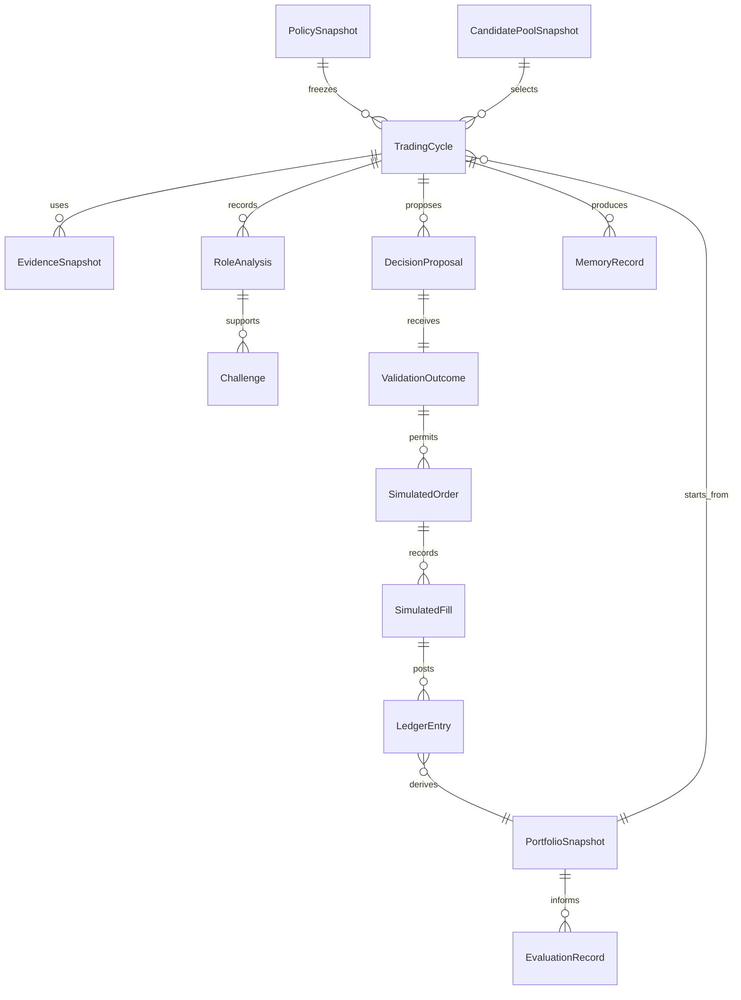

# Data Model

This document owns entity relationships and lifecycle meaning. Field-level
implemented types remain in Python and generated schemas; interface invariants
are in [contracts](contracts.md). Target names below are conceptual, not claims
that classes or endpoints already exist. Status is tracked in [tasks](tasks.md).

## Shared value rules

Use immutable, schema-versioned values with stable IDs, closed enums, explicit
units/currency, strict unknown-field rejection and validated UTC timestamps.
Canonical content hashes bind persisted inputs and outputs. Numeric values use
deterministic Decimal rules; mutable caller containers cannot change frozen
objects. Distinguish missing/unavailable from zero or an empty successful result.

Preserve source observation, source publication/availability, retrieval, evidence
cutoff, decision, calculation, effective session, and publication times. Scheduled
future events may be known at cutoff; their event time is not evidence-availability
time. Instrument identity is stronger than a ticker string and must survive
explicit corporate-action handling.

## Existing entities and ownership

| Existing entity or family | Meaning | Implementation reference |
| --- | --- | --- |
| ConfigurationSnapshot and policies | Complete frozen values/versions/hashes of validated configuration | [models](../src/finance_research_agent/domain/models.py), [policies](../src/finance_research_agent/domain/policies.py) |
| RunContextSeed and RunContext | Application-supplied immutable seed and repository-assigned date/revision identity, cutoff binding and component versions | [models](../src/finance_research_agent/domain/models.py), [run service](../src/finance_research_agent/application/run_service.py) |
| Evidence, source health and capabilities | Provenance, availability, quality and scoped failures | [models](../src/finance_research_agent/domain/models.py), [quality](../src/finance_research_agent/domain/quality.py) |
| MarketSnapshot and MetricResult | Normalized market data and deterministic calculations with units/windows/evidence | [models](../src/finance_research_agent/domain/models.py), [metrics](../src/finance_research_agent/domain/metrics.py) |
| ResearchPacket | Immutable synthesis input, including gates, exclusions, conflicts and limitations | [packets](../src/finance_research_agent/domain/packets.py) |
| ResearchBriefDraft and validation | Untrusted structured narrative submitted against the stored packet | [validation](../src/finance_research_agent/domain/validation.py) |
| TradePlanDraft and PositionSizing | Conditional research plan and analytical sizing; no order, fill or holdings claim | [plans](../src/finance_research_agent/domain/plans.py), [sizing](../src/finance_research_agent/domain/sizing.py) |
| PlanObservation | Completed-bar observations, ambiguity and post-observation MFE/MAE; not execution/PnL | [observations](../src/finance_research_agent/domain/observations.py) |
| Published bundle, receipt and telemetry | Immutable output, original publication time and bounded measured run facts | [publication](../src/finance_research_agent/application/publication_service.py), [telemetry](../src/finance_research_agent/application/performance_telemetry.py) |
| Evaluation evidence, feedback and readiness | Loader-verified receipts, operator observations, citation reviews and separate readiness statuses | [evaluation models](../src/finance_research_agent/evaluation/models.py) |

The historical `domain.market.MarketSnapshot` alias means `RegimeMarketSnapshot`;
it remains distinct from the canonical Product A `domain.models.MarketSnapshot`.
Legacy plan states remain DRAFT, REVIEW_REQUIRED, BLOCKED and EXPIRED. They do
not acquire approval or simulated-execution meaning through a documentation change.

## Target relationships

The diagram expresses conceptual cardinalities, not final storage tables. A
proposal can yield rejection or no trade and therefore zero orders. An ordinary
order produces zero or one fill for its full quantity after approved split
adjustments, with no partial fill or remainder carried forward. Proposal batching
and protective-order cardinalities are proposed in the target state/contract
sections below and require T05 review before activation.

| Target entity | Required semantic content |
| --- | --- |
| PolicySnapshot | Candidate, risk, source, execution, evaluation and budget versions/values; explicit approval/effective boundary |
| CandidatePoolSnapshot | Eligible known instruments and user-maintained membership as of the cycle |
| TradingCycle | Identity/revision, trigger, exchange session, cutoff, stage, budgets, terminal outcome, parent/previous cycle and portfolio version |
| EvidenceSnapshot | Normalized evidence, source/availability/retrieval times, quality/conflicts, hashes, required-role coverage |
| RoleAnalysis | Role/runtime identity, input artifact hashes, typed claims, metrics/evidence references, thesis, uncertainty and completion status |
| Challenge | Counter-thesis, invalidation, material gaps and bounded supplementary requests with resolution/unresolved status |
| DecisionProposal | Proposed portfolio action, subject, rationale/counter-rationale, requested risk/allocation, protective intent, horizon and source analyses |
| ValidationOutcome | Exact policy/portfolio/evidence versions, gates, deterministic numbers, accepted/rejected/no-trade status and reasons |
| SimulatedOrder | Accepted intent, instrument/side/quantity, eligible session, order/protection semantics, policy version, lifecycle and idempotency identity |
| SimulatedFill | Order reference, eligible market evidence, simulated price/quantity, effective session and supported event-time precision, actual processing time, fees/slippage and execution-rule version |
| LedgerEntry | Immutable cash/quantity/cost effect with source event and deduplication identity; includes funding, settlement transfers, split adjustments, dividend receivables and their cash payments |
| PortfolioSnapshot | Ledger revision, valuation session/close and source-price references, settled cash available for purchases, unsettled sale proceeds with settlement dates, dividend receivables/income, positions with remaining acquisition cost and weighted-average cost per share, unadjusted marks, exposure, equity, realized/unrealized trading results and unavailable fields |
| MemoryRecord | Hypothesis/decision/outcome/reflection kind, availability time, linked evidence/run/policy and counter-evidence; no implicit policy authority |
| EvaluationRecord | Identity/revision and prior-evaluation link; independent portfolio/funding identity, positive initial capital, starting/ending sessions, versioned metric and benchmark rules, frozen benchmark universe/data/cost references, input ledger/decision references, scheduled observation dates, input coverage/missing-input reasons, per-metric availability/results and limitations |

## Lifecycle boundaries

The target lifecycle must distinguish collecting, frozen research, analysis and
challenge, proposed decision, local validation, accepted pending execution,
simulated execution/accounting, evaluation and terminal states. The proposed
transition tables below separate these responsibilities; T05 reviews the exact
schema and executable transition fixtures before coding the application slice.

For ordinary orders, distinguish full execution, terminal rejection, confirmed
expiry and an unresolved outcome awaiting valid evidence. An unresolved outcome
remains bound to its original opening; late data does not grant a new execution
session. Preserve the accepted quantity and terminal reason in the order history.
Split adjustments preserve the original accepted quantity and append the event
that determines the effective quantity; they do not rewrite the original order.

Replacement records link the original instruction, proposed replacement,
validation outcome and effective boundary. Failed validation preserves the
original's active state. A successful replacement changes both instructions
together while retaining their history; a scheduled protective-stop replacement
does not deactivate current protection before its effective session. Record
standalone cancellations separately, with timing and safety-check outcomes.

An opening-triggered protective stop supersedes an overlapping ordinary sell
under [FR-06](spec.md#fr-06-simulated-execution-and-accounting). Preserve the
ordinary order as cancelled with its supersession reason and link to the stop
execution, rather than assigning it a duplicate fill. A later daily-low stop
can consume only the shares remaining after ordinary opening sells.

Settlement transfers already-recorded sale proceeds from unsettled to settled
cash under [FR-01](spec.md#fr-01-instruments-and-portfolio); it does not create a
second sale credit or additional equity. Preserve trade and settlement dates
separately from the actual processing timestamp during catch-up.

Position cost records retain acquisition costs, allocated cost of sold shares
and remaining cost under the weighted-average policy in
[FR-06](spec.md#fr-06-simulated-execution-and-accounting). Bind those allocations
to the original fills and fees; keep dividend income distinct from realized
trading profit and do not post slippage a second time after its fill-price effect.

Closing snapshots bind the ledger effective by that session's close and its
unadjusted closing marks. Retain the cash, receivable and position-value components
of equity, plus remaining acquisition cost for unrealized trading results, under
the FR-06 valuation definition; unavailable inputs remain explicit.

Corporate-action records bind verified terms, effective dates, source identity
and affected holdings/orders. A dividend receivable is an equity component but
cannot fund a purchase; payment transfers it to available cash without crediting
income twice. Split adjustments conserve economic holdings and cost basis under
the event terms. Unsupported or incomplete terms retain an unresolved state,
including any residual entitlement, rather than fabricated cash or discarded shares.

Durable local records are authoritative across Work conversations. The next
mutation must identify expected run/portfolio version and its idempotency key.
Atomic persistence must cover effects and receipts so a crash cannot leave a
successful fill unaccounted for or apply the same effect twice. Historical states
are immutable; corrections append records or create a distinct revision.

Do not mix identities: a thesis is not a decision, a proposal is not an accepted
order, an order is not a fill, a research observation is not a fill, and a
generated report is not a ledger. Work role output is untrusted until validated.

## As-of visibility and migration

Memory and evaluation outputs carry their first availability time. Future
outcomes cannot enter an earlier decision's evidence. Deterministic replay loads
stored accepted decisions, data, policy, simulator version and prior state; a
fresh model run receives a new experiment identity.

Evaluation records retain every regular session's scheduled closing observation,
including sessions without agent activity and dates with unavailable valuations,
with metric-specific completeness under [FR-09](spec.md#fr-09-evaluation).
The funding reference anchors cumulative returns and the initial drawdown peak;
daily returns reference the preceding scheduled valuation, not the last available
one across a gap. A starting-capital change creates an independent portfolio and
evaluation identity, rather than a funding adjustment or revision of the old one.
Recovered inputs create a new linked evaluation revision; they do not overwrite
earlier coverage, results or input references.

Preserve old artifacts under their original schema and component versions. Add
new simulated entities rather than changing the meaning of old research fields.
Any adapter or migration must state supported versions, derive a separate view,
and retain original bytes/hashes. New fields require explicit compatibility tests;
silent defaults must not fabricate evidence, fills, positions or model provenance.

## Versioned target records

The following is the proposed `trading.v1` design for T03–T05 review, not an
implemented Python or wire schema. Common fields are `record_type`,
`schema_version`, stable `record_id`, `portfolio_id`, `recorded_at` (UTC),
`content_hash`, and explicit references to immutable input versions. Content
hashes exclude their own hash field. IDs are application-assigned; model-supplied
IDs must resolve to authorized existing objects. Financial values are Decimal
strings with units, never JSON floating-point values.

| Record | Mandatory fields beyond the common envelope | Validation and relationship |
| --- | --- | --- |
| PolicySnapshot | Full source/risk/execution/evaluation/budget values, component hashes, approval reference, effective cycle/session | New policy cannot reinterpret an accepted decision; absent required numeric values block use |
| CalendarSnapshot | Trading/settlement kind, calendar/version, timezone, covered date range, session opens/closes or settlement business dates, provenance/hash | XNYS sessions do not stand in for settlement dates; out-of-coverage dates are unavailable |
| CycleInputManifest | Cycle/revision, pool/policy/portfolio hashes, calendar references, evidence cutoff, deadline, runtime and budget manifest | All role outputs refer to one frozen manifest; revisions link parents without rewriting them |
| CommandReceipt | Command ID/kind, authenticated actor class, request hash, expected/committed versions, result, effect IDs, accepted/recorded times | Same key and request returns original result; different payload conflicts; no effect without a durable receipt |
| ReconciliationCursor | Portfolio/instrument scope, last proven event phase/session, input hashes, blocked dependencies/reasons | A cursor advances only with its committed effects; unresolved state is not a completed session |
| CorporateAction | Source event ID/revision, instrument identity, event type, terms, effective/entitlement/payment boundaries, availability/retrieval times | Separate verified terms from generated timestamps; unknown terms block affected adjustments |
| InstructionChange | Original/replacement IDs, request and local acceptance times, validation, effective boundary, active-until boundary | Failed change leaves original active; successful replacement/cancellation is atomic at its boundary |
| SettlementLot | Source sell fill, net amount, trade date, settlement date/calendar hash, unsettled/settled status | Exactly one transfer; sale proceeds cannot be credited twice |
| DividendReceivable | Event ID, entitlement quantity and evidence, per-share amount, total amount, verified payment date, paid/unpaid status | Entitlement creates income/receivable once; payment moves the same amount to settled cash |
| LedgerBatch | Prior ledger version/hash, ordered immutable entries, semantic event key, rule versions, resulting projection hash | One atomic commit; entry order and amounts reconstruct the projection without current configuration |
| LedgerEntry | Kind, source event/fill, effective session/phase, amount/quantity/cost deltas, before/after references | Funding, buy/sell, settlement, split and dividend effects have distinct kinds; no synthetic balancing plug |
| ClosingObservation | Scheduled session/close, effective ledger hash, raw-price evidence IDs, component values or unavailable reasons | One observation slot per scheduled close per evaluation revision, even without a cycle |
| EvaluationManifest | Funding, portfolio/ledger, calendar, universe, metric/baseline/execution versions, input hashes, date range, prior revision | Agent/cash/buy-hold share observation dates and assumptions; recovered data derives a new revision |
| MetricResult | Metric ID/version, required-input manifest, value/unit or reasons, numerator/denominator when applicable | Missing denominator/input is unavailable, never zero by default; results bind coverage and provenance |

`MetricResult` here is a trading evaluation record in its own namespace; it does
not replace the existing research `domain.models.MetricResult`. Role submissions
also carry role, round, assignment ID, input-manifest hash, completion status,
claim/evidence references and host-provided provenance or explicit unavailability.
A model may report requested allocation; only local validation creates an accepted
quantity, order or authoritative metric.

## Target state transitions

Cycle stage and order/ledger progress are separate. Completing a decision cycle
does not assert that a later order filled. One active mutating cycle per portfolio
uses optimistic versions; independent read-only research can still occur.

| Cycle stage | Successful next stage | Required guard or alternate outcome |
| --- | --- | --- |
| CREATED | RECONCILING | Valid approved configuration, finite budgets, current portfolio version |
| RECONCILING | COLLECTING | Prior effective events resolved for dependent decisions; otherwise BLOCKED with cursor |
| COLLECTING | FROZEN | Input manifest and cutoff fixed atomically; missing evidence remains explicitly scoped |
| FROZEN | ANALYZING | Authorized bounded role assignments use the same manifest |
| ANALYZING | CHALLENGING | Required analyst artifacts exist, including honest partial/unavailable statuses |
| CHALLENGING | SUPPLEMENTING or PROPOSING | At most one supplementary round; material unresolved gaps restrict proposals |
| SUPPLEMENTING | PROPOSING | No second research round; later-cutoff evidence requires a successor cycle revision |
| PROPOSING | VALIDATING | Structured proposal references recorded analyses/challenge and expected portfolio |
| VALIDATING | COMPLETED | Atomic accepted orders, per-action rejections or no-trade result plus receipt |

Any nonterminal stage can become BLOCKED (resumable only with original inputs and
permitted repair), CANCELLED, DEADLINE_EXCEEDED or BUDGET_EXHAUSTED. Terminal states
retain prior effects and cannot be silently reopened. A required new cutoff or
policy uses a new cycle revision; recorded actions are never applied again.
Transport interruption alone changes no stage. Resume reads durable status and
receipts, reconstructs missing work, and consumes the remaining original budget.
Successor revisions share the root cycle's deadline, counters and consumed
supplementary allowance; they cannot reset them. New-manifest role outputs need
explicit reissue/revalidation or validated reuse links preserving the originals
before proposal/validation proceeds. Exhaustion ends that cycle lineage.
Pause is a persistent portfolio control, not cancellation of the research cycle.

| Instruction | Legal outcomes |
| --- | --- |
| Ordinary ACCEPTED_PENDING | FILLED (one full-quantity fill), REJECTED (cash/risk/invalid entry), EXPIRED (verified opening nonexecution), CANCELLED (valid pre-opening change/pause/supersession), or UNRESOLVED (missing evidence) |
| Ordinary UNRESOLVED | Resolve only the original opening to FILLED/REJECTED/EXPIRED or deterministic CANCELLED from a proven prior control/opening-stop supersession; otherwise retain the block; no new post-opening user cancellation or carryover |
| Protective ACTIVE | Remains ACTIVE, FILLED for remaining protected shares, CANCELLED after full exit/safe explicit cancellation, SUPERSEDED at replacement boundary, or UNRESOLVED |
| Replacement PENDING_EFFECTIVE | Atomic activation plus old-instruction supersession; rejected validation never enters this state; effective-boundary failure retains the original |

An unresolved instruction retains its prior lifecycle and original opportunity;
it is not an assertion that no trade happened. Protective coverage follows current
held quantity, with one active whole-position stop per instrument in the first
technical profile. New buys/additions require one coherent protection plan for
the resulting holding. Conflicting simultaneous instructions are rejected rather
than netted into a different strategy. Cardinality and conflict checks are reviewed
with T05 before activation.

Every event has both `effective_session`/`phase` and `recorded_at`. Phase values
come from the [simulation schedule](contracts.md#target-simulation-schedule).
Daily-low stop events have session/phase precision only; do not fabricate a UTC
intraday trigger. Exact replay compares economic effects and effective ordering;
processing timestamps and delivery metadata can differ without changing economics.
