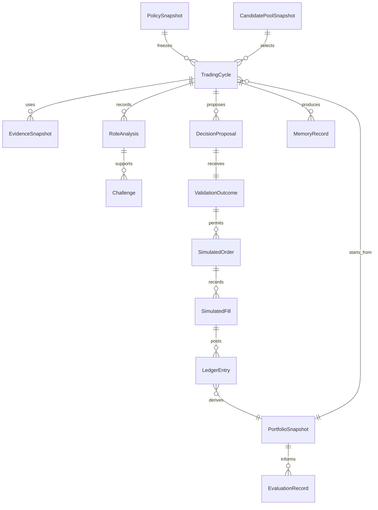

# Data Model

This document owns entity relationships and lifecycle meaning. Field-level
implemented types remain in Python and generated schemas; interface invariants
are in [contracts](contracts.md). Target names below are conceptual, not claims
that classes or endpoints already exist. Status is tracked in [tasks](tasks.md).

## Shared value rules

Use immutable, schema-versioned values with stable IDs, closed enums, explicit
units/currency, strict unknown-field rejection and validated UTC timestamps.
Canonical content hashes bind persisted inputs and outputs. Numeric values use
deterministic Decimal rules; mutable caller containers cannot change frozen
objects. Distinguish missing/unavailable from zero or an empty successful result.

Preserve source observation, source publication/availability, retrieval, evidence
cutoff, decision, calculation, effective session, and publication times. Scheduled
future events may be known at cutoff; their event time is not evidence-availability
time. Instrument identity is stronger than a ticker string and must survive
explicit corporate-action handling.

## Existing entities and ownership

| Existing entity or family | Meaning | Implementation reference |
| --- | --- | --- |
| ConfigurationSnapshot and policies | Complete frozen values/versions/hashes of validated configuration | [models](../src/finance_research_agent/domain/models.py), [policies](../src/finance_research_agent/domain/policies.py) |
| RunContextSeed and RunContext | Application-supplied immutable seed and repository-assigned date/revision identity, cutoff binding and component versions | [models](../src/finance_research_agent/domain/models.py), [run service](../src/finance_research_agent/application/run_service.py) |
| Evidence, source health and capabilities | Provenance, availability, quality and scoped failures | [models](../src/finance_research_agent/domain/models.py), [quality](../src/finance_research_agent/domain/quality.py) |
| MarketSnapshot and MetricResult | Normalized market data and deterministic calculations with units/windows/evidence | [models](../src/finance_research_agent/domain/models.py), [metrics](../src/finance_research_agent/domain/metrics.py) |
| ResearchPacket | Immutable synthesis input, including gates, exclusions, conflicts and limitations | [packets](../src/finance_research_agent/domain/packets.py) |
| ResearchBriefDraft and validation | Untrusted structured narrative submitted against the stored packet | [validation](../src/finance_research_agent/domain/validation.py) |
| TradePlanDraft and PositionSizing | Conditional research plan and analytical sizing; no order, fill or holdings claim | [plans](../src/finance_research_agent/domain/plans.py), [sizing](../src/finance_research_agent/domain/sizing.py) |
| PlanObservation | Completed-bar observations, ambiguity and post-observation MFE/MAE; not execution/PnL | [observations](../src/finance_research_agent/domain/observations.py) |
| Published bundle, receipt and telemetry | Immutable output, original publication time and bounded measured run facts | [publication](../src/finance_research_agent/application/publication_service.py), [telemetry](../src/finance_research_agent/application/performance_telemetry.py) |
| Evaluation evidence, feedback and readiness | Loader-verified receipts, operator observations, citation reviews and separate readiness statuses | [evaluation models](../src/finance_research_agent/evaluation/models.py) |

The historical `domain.market.MarketSnapshot` alias means `RegimeMarketSnapshot`;
it remains distinct from the canonical Product A `domain.models.MarketSnapshot`.
Legacy plan states remain DRAFT, REVIEW_REQUIRED, BLOCKED and EXPIRED. They do
not acquire approval or simulated-execution meaning through a documentation change.

## Target relationships

The diagram expresses conceptual cardinalities, not final storage tables. A
proposal can yield rejection or no trade and therefore zero orders. The exact
single/batch proposal and fill cardinalities await [simulation decisions](research.md#rq-03-simulation-semantics).

| Target entity | Required semantic content |
| --- | --- |
| PolicySnapshot | Candidate, risk, source, execution, evaluation and budget versions/values; explicit approval/effective boundary |
| CandidatePoolSnapshot | Eligible known instruments and user-maintained membership as of the cycle |
| TradingCycle | Identity/revision, trigger, exchange session, cutoff, stage, budgets, terminal outcome, parent/previous cycle and portfolio version |
| EvidenceSnapshot | Normalized evidence, source/availability/retrieval times, quality/conflicts, hashes, required-role coverage |
| RoleAnalysis | Role/runtime identity, input artifact hashes, typed claims, metrics/evidence references, thesis, uncertainty and completion status |
| Challenge | Counter-thesis, invalidation, material gaps and bounded supplementary requests with resolution/unresolved status |
| DecisionProposal | Proposed portfolio action, subject, rationale/counter-rationale, requested risk/allocation, protective intent, horizon and source analyses |
| ValidationOutcome | Exact policy/portfolio/evidence versions, gates, deterministic numbers, accepted/rejected/no-trade status and reasons |
| SimulatedOrder | Accepted intent, instrument/side/quantity, eligible session, order/protection semantics, policy version, lifecycle and idempotency identity |
| SimulatedFill | Order reference, eligible market evidence, simulated price/quantity/time, fees/slippage and execution-rule version |
| LedgerEntry | Immutable cash/quantity/cost effect with source event and deduplication identity; includes funding and approved corporate-action events |
| PortfolioSnapshot | Ledger revision, cash availability, positions/cost basis, marks, exposure, equity, realized/unrealized results and unavailable fields |
| MemoryRecord | Hypothesis/decision/outcome/reflection kind, availability time, linked evidence/run/policy and counter-evidence; no implicit policy authority |
| EvaluationRecord | Versioned metric/baseline assumptions, input ledger/decision references, observation interval and limitations |

## Lifecycle boundaries

The target lifecycle must distinguish collecting, frozen research, analysis and
challenge, proposed decision, local validation, accepted pending execution,
simulated execution/accounting, evaluation and terminal states. These are stage
responsibilities, not a finalized enum. The technical slice must define legal
transitions, duplicate/stale commands, one supplementary round, cancellation,
pause effects, and failure/recovery at each transition before coding it.

Durable local records are authoritative across Work conversations. The next
mutation must identify expected run/portfolio version and its idempotency key.
Atomic persistence must cover effects and receipts so a crash cannot leave a
successful fill unaccounted for or apply the same effect twice. Historical states
are immutable; corrections append records or create a distinct revision.

Do not mix identities: a thesis is not a decision, a proposal is not an accepted
order, an order is not a fill, a research observation is not a fill, and a
generated report is not a ledger. Work role output is untrusted until validated.

## As-of visibility and migration

Memory and evaluation outputs carry their first availability time. Future
outcomes cannot enter an earlier decision's evidence. Deterministic replay loads
stored accepted decisions, data, policy, simulator version and prior state; a
fresh model run receives a new experiment identity.

Preserve old artifacts under their original schema and component versions. Add
new simulated entities rather than changing the meaning of old research fields.
Any adapter or migration must state supported versions, derive a separate view,
and retain original bytes/hashes. New fields require explicit compatibility tests;
silent defaults must not fabricate evidence, fills, positions or model provenance.
