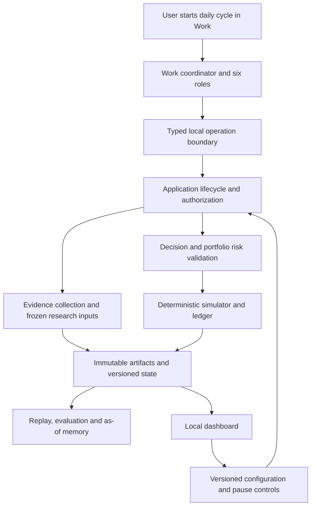

# Architecture and Migration Plan

Status: target architecture approved; this revision authorizes documentation
consolidation only. Resolve the [research gates](research.md#implementation-gates)
and review the concrete first implementation slice before production changes.
Behavior belongs to [spec](spec.md); work/evidence belongs to [tasks](tasks.md).

## Architecture decision

Keep the deterministic local Python core and durable storage. Use ChatGPT Work
for the first production reasoning/orchestration host through a bounded typed
tool interface. Add simulated execution/accounting as explicit local domain
capabilities and a local dashboard as a client. Adapt current skills and MCP
operations after the host feasibility spike proves the actual connection.

Work can plan research and delegate roles, but local application services decide
which operation is valid in the current lifecycle and commit all authoritative
effects. A model call, role output, registry lookup, or UI action does not bypass
that boundary. Generic AgentRuntime remains separate; it need not become the
workflow engine or be replaced to support an external host.

## Alternatives and trade-offs

| Option | Assessment |
| --- | --- |
| Extend only the existing research skill workflow | Reuses delivery but does not supply the approved persistent decision/portfolio loop |
| Copy TradingAgents wholesale | Useful role/debate reference; introduces architecture and dependencies without proving this project's ledger, evidence, or host requirements |
| Build a standalone API runtime first | Offers direct model API control but adds billing/integration work before proving the requested Work route |
| Work plus deterministic local services | Selected; reuses available host reasoning while preserving local authority, with an explicit host-compatibility and usage-visibility gate |

No dashboard framework, additional data vendor, new runtime SDK, or transport
deployment is selected solely by this document. Those choices must satisfy the
bounded research criteria and incremental budget.

## Module responsibilities

| Boundary | Owns | Must not own |
| --- | --- | --- |
| Domain | Evidence/time rules, calculations, risk, simulator/accounting invariants | Provider payloads, prompts, UI, host sessions |
| Application | Frozen context, lifecycle, policy enforcement, idempotency, persistence coordination | Agent-generated numeric truth or UI-specific behavior |
| Adapters | Approved data access, storage, host transport, serialization | Reinterpretation of financial or authorization policy |
| Work roles | Research decomposition, critique, judgments and structured proposals | Ledger writes, invented source facts, direct broker access |
| Dashboard | Read models, configuration editing, status and human controls | A second ledger or independent financial calculations |
| Evaluation and memory | Versioned results, replay, as-of retrieval and reflections | Implicit strategy/risk mutation or future evidence leakage |

Provider adapters normalize into domain contracts. Domain/application code stays
independent of agent/host packages. Side effects have explicit command semantics,
preconditions and deduplication. Queries cannot quietly mutate state. Reuse the
existing HTTP, artifact, version and configuration boundaries where their
semantics fit; do not copy old premarket assumptions into new portfolio code.

## Research and decision flow

The target cycle reconciles prior simulated state, freezes policy and admissible
inputs, collects shared market context and candidate analyses, records challenge,
allows one supplementary research round, and persists a portfolio proposal.
Local validation computes risk/quantity and constructs accepted next-session
orders or explicit rejections. Subsequent data drives deterministic fills,
accounting, evaluation and reflection. A report is a view of these records.

The [data model](data-model.md) records lifecycle relationships; the
[interface contract](contracts.md#target-interface-boundary) states invariants.
Simulation/accounting and evaluation policies are defined in
[FR-06](spec.md#fr-06-simulated-execution-and-accounting) and
[FR-09](spec.md#fr-09-evaluation). Detailed event schedules, numerical precision,
state transitions and effective-time contracts remain work for RQ-03/RQ-04
before implementation. Restart and pause behavior are defined in
[FR-02](spec.md#fr-02-cadence-and-bounded-cycles) and
[FR-08](spec.md#fr-08-dashboard-and-controls); their exact state transitions and
effective-time rules must follow the approved behavior in those technical
contracts. These policy approvals do not establish implemented capabilities.

## Migration strategy

1. Preserve the current research API profile and historical artifacts. Replace
   documentation authority first, with no runtime or financial behavior change.
2. Prove Work/local tool connectivity and minimum data availability/cost. Capture
   actual evidence in the canonical research and tasks documents; no new report
   or spike-plan copies. Keep experimental code isolated and disposable.
3. Define versioned cycle/decision/portfolio contracts and approved deterministic
   simulator rules. Reuse current evidence and persistence mechanisms only after
   verifying their changed lifecycle assumptions.
4. Deliver one small end-to-end vertical slice: a known candidate, frozen
   evidence, structured host proposal, local risk check, next-session simulated
   fill, position/cash, report, and exact replay. It is an integration proof,
   not the complete six-role release.
5. Expand to the full role team, candidate pool, portfolio interactions,
   protective orders, failures/recovery, durable memory, dashboard and evaluation.
6. Migrate existing brief/skills/consumers to the new loop, document intentional
   interface breaks, and retire redundant current paths after parity or an
   explicit approved behavior change. Historical artifacts remain readable under
   their original schema/semantics.

Tests, security review, deterministic replay and operational evidence accompany
every stage. Release validation is not postponed until the final stage.

## Delivery gates

| Stage | Entry | Exit evidence |
| --- | --- | --- |
| D0 Documentation | Confirmed product decisions | Canonical documents, migrated references, preserved compatibility, checks and final diff |
| D1 Feasibility | Review of bounded spike scope | Actual Work transport/subagent/structured-return/resume trace, source matrix, budget analysis, resolved simulator/evaluation policies |
| D2 First vertical slice | Reviewed contracts and implementation scope | One deterministic lifecycle, restart/idempotency tests, replay, observable local output |
| D3 Product completion | Proven D2 boundary | Six roles, multiple candidates, portfolio protection/accounting, failures, memory and dashboard meet FR-01–FR-12 |
| D4 Release evidence | Required functional checks pass | Installed-host evidence, frozen replay corpus, forward paper results and fair baselines; distinguish engineering readiness from observed performance |

Approval of the product target is not approval to skip these gates. No production
implementation begins in D0. A failed Work feasibility gate returns an explicit
architecture decision to the user; it does not silently switch to paid APIs.

## Compatibility and verification

Keep package version `0.5.0.dev0` unchanged for D0. Do not edit `src`, generated
schemas, runtime prompts/skills/manifests, dependency locks, or financial policies
for documentation housekeeping. Update documentation tooling/tests only where
canonical paths and authority responsibilities changed. Keep negative checks for
broken links, authority loss, rewritten history, and unsafe scheduling prompts.

Run repository tests, Ruff, mypy, generated-schema and documentation checks, and
inspect the final diff. Use the existing offline network boundary. Validate the
secret scan against the actual intended file inventory, including new documents
and removed paths; do not bootstrap away new findings. Remote CI and installed
host checks require their own actual evidence.

Future changes must test financial boundaries and failure semantics, not merely
mirror implementation. Review preserved API consumers and version migrations
before changing a current contract. Required source checks and operator release
procedures are owned by [operations](operations.md).
