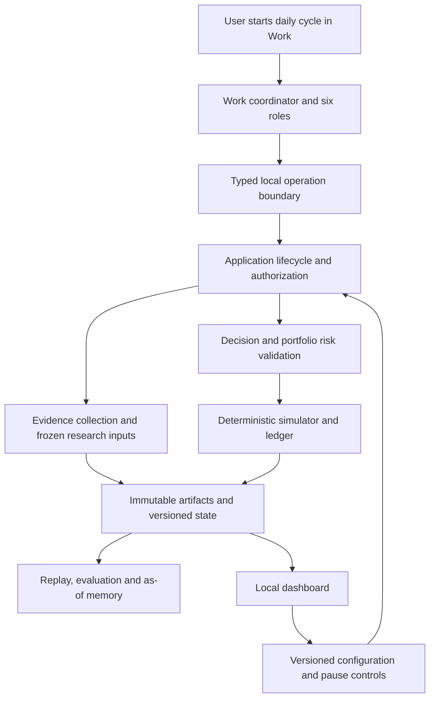

# Architecture and Migration Plan

Status: canonical technical planning revision, 2026-10-23, on branch `main`,
based on `dcd0e2b`. The product target and all fifteen clarifications are accepted.
This revision specifies the design for review; it authorizes documentation only.
Resolve the [research gates](research.md#implementation-gates) and review the
concrete first implementation slice before production changes.
Behavior belongs to [spec](spec.md); work/evidence belongs to [tasks](tasks.md).

## Technical context

| Concern | Inspected baseline and planned boundary |
| --- | --- |
| Language and version | Python 3.12+, package `0.5.0.dev0`; current CI covers 3.12, 3.13 and 3.14 |
| Dependencies | Existing Pydantic 2.13.5, MCP 2.2.0, Alpaca SDK 0.44.0, PyYAML 6.0.3, bounded httpx and exchange-calendars ranges; preserve lock files |
| Product/platform | One local user and USD simulated account on the existing macOS workstation; manually started Work reasoning, typed local Python services, later local dashboard |
| Storage | Preserve file-based research runs. Proposed new portfolio repository uses standard-library SQLite transactions plus immutable canonical artifact bytes; no server database or ORM |
| Calculation | Explicit Decimal context, whole shares, raw execution/valuation prices, versioned exchange and settlement calendars; no host-calculated authoritative numbers |
| Scale | Known candidate pool, roughly 10–30 as a planning expectation; one active mutating portfolio cycle, six logical roles, at most one supplementary round |
| Limits/performance | Freeze finite deadline, call, retry, payload and delegation limits before a cycle. T01 measures practical values; no invented throughput/SLA or reuse of the old premarket deadline |
| Tests | Offline pytest with network guard, Ruff, mypy, schema drift, documentation/link and secret checks; separate actual-host/source receipts |
| External dependencies | Actual Work transport/permissions, provider entitlements and settlement/event coverage, incremental-cost visibility remain evidence gates; see the research register |

Required runtime/risk parameters are typed configuration inputs, not silent
defaults. Missing values disable the affected operation. A blocked external
dependency does not justify a fallback vendor, paid API, fabricated evidence,
or a claim that the target is runnable.

## Constitution check

Pre-research and post-design checks both pass for this documentation scope:

| Gate | Design evidence |
| --- | --- |
| Deterministic financial/state authority | Local validation, simulator and ledger own all accepted effects; role proposals are untrusted |
| Immutable history and time | Frozen input/version manifests, event-time reconciliation, command receipts and separate evaluation revisions |
| Scoped failures | Missing instrument evidence blocks that dependency; incomplete portfolio state blocks portfolio-wide risk/cash decisions |
| Human policy authority | Required approval/effective-time references; no invented risk defaults, purchases, autonomous policy changes or real execution |
| Security and reproducibility | Closed operations, host-bound permissions, confined local storage, offline replay/tests, no model-controlled paths/SQL/network |
| Single document authority | Update the ten canonical categories in place; `contracts.md` replaces the skill's generic `contracts/` output |
| Evidence honesty | Host/source/budget gates remain open until observed; design and arithmetic checks are not simulator/release evidence |

No constitutional exception is requested. The installed Spec Kit constitution
is an unfilled template; [constitution.md](constitution.md) remains authoritative.
The setup script requires absent feature state, so read-only path resolution maps
the workflow to `docs/` without creating another spec or changing the installation.
Phase 0 desk research and Phase 1 contract design can be delivered with explicit
readiness blockers. The implementation gate is **NOT READY** until the evidence
and review requirements below pass; no unresolved product choice is treated as
an accepted implementation assumption.

## Architecture decision

Keep the deterministic local Python core and durable storage. Use ChatGPT Work
for the first production reasoning/orchestration host through a bounded typed
tool interface. Add simulated execution/accounting as explicit local domain
capabilities and a local dashboard as a client. Adapt current skills and MCP
operations after the host feasibility spike proves the actual connection.

Work can plan research and delegate roles, but local application services decide
which operation is valid in the current lifecycle and commit all authoritative
effects. A model call, role output, registry lookup, or UI action does not bypass
that boundary. Generic AgentRuntime remains separate; it need not become the
workflow engine or be replaced to support an external host.

## Alternatives and trade-offs

| Option | Assessment |
| --- | --- |
| Extend only the existing research skill workflow | Reuses delivery but does not supply the approved persistent decision/portfolio loop |
| Copy TradingAgents wholesale | Useful role/debate reference; introduces architecture and dependencies without proving this project's ledger, evidence, or host requirements |
| Build a standalone API runtime first | Offers direct model API control but adds billing/integration work before proving the requested Work route |
| Work plus deterministic local services | Selected; reuses available host reasoning while preserving local authority, with an explicit host-compatibility and usage-visibility gate |

No dashboard framework, additional data vendor, new runtime SDK, or transport
deployment is selected solely by this document. Those choices must satisfy the
bounded research criteria and incremental budget.

## Module responsibilities

| Boundary | Owns | Must not own |
| --- | --- | --- |
| Domain | Evidence/time rules, calculations, risk, simulator/accounting invariants | Provider payloads, prompts, UI, host sessions |
| Application | Frozen context, lifecycle, policy enforcement, idempotency, persistence coordination | Agent-generated numeric truth or UI-specific behavior |
| Adapters | Approved data access, storage, host transport, serialization | Reinterpretation of financial or authorization policy |
| Work roles | Research decomposition, critique, judgments and structured proposals | Ledger writes, invented source facts, direct broker access |
| Dashboard | Read models, configuration editing, status and human controls | A second ledger or independent financial calculations |
| Evaluation and memory | Versioned results, replay, as-of retrieval and reflections | Implicit strategy/risk mutation or future evidence leakage |

Provider adapters normalize into domain contracts. Domain/application code stays
independent of agent/host packages. Side effects have explicit command semantics,
preconditions and deduplication. Queries cannot quietly mutate state. Reuse the
existing HTTP, artifact, version and configuration boundaries where their
semantics fit; do not copy old premarket assumptions into new portfolio code.

## Research and decision flow

The target cycle reconciles prior simulated state, freezes policy and admissible
inputs, collects shared market context and candidate analyses, records challenge,
allows one supplementary research round, and persists a portfolio proposal.
Local validation computes risk/quantity and constructs accepted next-session
orders or explicit rejections. Subsequent data drives deterministic fills,
accounting, evaluation and reflection. A report is a view of these records.

The [data model](data-model.md) records lifecycle relationships; the
[interface contract](contracts.md#target-interface-boundary) states invariants.
Simulation/accounting and evaluation policies are defined in
[FR-06](spec.md#fr-06-simulated-execution-and-accounting) and
[FR-09](spec.md#fr-09-evaluation). Detailed event schedules, numerical precision,
state transitions and effective-time contracts are specified for review in
[target contracts](contracts.md#target-interface-boundary). RQ-03/RQ-04 still
require reviewed executable fixtures before implementation readiness. Restart
and pause behavior are defined in
[FR-02](spec.md#fr-02-cadence-and-bounded-cycles) and
[FR-08](spec.md#fr-08-dashboard-and-controls); their exact state transitions and
effective-time rules must follow the approved behavior in those technical
contracts. These policy approvals do not establish implemented capabilities.

## Migration strategy

1. Preserve the current research API profile and historical artifacts. Replace
   documentation authority first, with no runtime or financial behavior change.
2. Prove Work/local tool connectivity and minimum data availability/cost. Capture
   actual evidence in the canonical research and tasks documents; no new report
   or spike-plan copies. Keep experimental code isolated and disposable.
3. Define versioned cycle/decision/portfolio contracts and approved deterministic
   simulator rules. Reuse current evidence and persistence mechanisms only after
   verifying their changed lifecycle assumptions.
4. Deliver one small end-to-end vertical slice: a known candidate, frozen
   evidence, structured host proposal, local risk check, next-session simulated
   fill, position/cash, report, and exact replay. It is an integration proof,
   not the complete six-role release.
5. Expand to the full role team, candidate pool, portfolio interactions,
   protective orders, failures/recovery, durable memory, dashboard and evaluation.
6. Migrate existing brief/skills/consumers to the new loop, document intentional
   interface breaks, and retire redundant current paths after parity or an
   explicit approved behavior change. Historical artifacts remain readable under
   their original schema/semantics.

Tests, security review, deterministic replay and operational evidence accompany
every stage. Release validation is not postponed until the final stage.

## Persistence and compatibility design

Select a separate `TradingRepository` for the new account lifecycle. A single
SQLite database beneath the confined private data root stores canonical immutable
artifact bytes/hashes, append-only events, command receipts, and rebuildable
projections. One transaction commits the event batch, receipt, expected-version
advance and projection; a lost response can be retried without repeating effects.
Use explicit transaction control, foreign keys, a rollback journal and full
synchronization for the initial single-writer design. Do not use SQL floating-point
arithmetic for financial values. Check supported SQLite features on startup and
test crash/disk-full/rollback behavior on the installed runtime. Backup/restore
uses a consistent database snapshot and verifies hashes and reconstructed state.

This is a proposed adapter choice within the accepted local-storage architecture.
Alternatives: extending multi-file research publication would require a new
cross-file commit/recovery protocol; a server database adds deployment overhead
for one local account. SQLite supplies a transaction boundary without an added
Python package. It adds schema-migration/backup obligations and serializes writes;
T05 must review those trade-offs and the bounded lock timeout before implementation.
The reasoning is supported by [Python transaction control](https://docs.python.org/3.12/library/sqlite3.html#transaction-control)
and [SQLite transactions](https://www.sqlite.org/transactional.html), not by an
unperformed repository spike.

Existing `FileSystemRunRepository`, generated schemas, eleven Product A operations,
three runtime skills and old replay/scorecard semantics remain unchanged. New
`trading.v1` artifacts have their own schema/simulator/evaluation versions. Legacy
artifacts may be hash-verified evidence references; they never become orders,
fills, or portfolio balances. Preserve original bytes when deriving views.
Unsupported versions fail closed. Schema migrations require a backup, fixture
reader compatibility and explicit consumer migration before activation. Reports
are projections, not a second source of account state.

## Project structure and bounded delivery

Source paths below are relative to `src/finance_research_agent/`; test paths are
relative to the repository root. Paths are proposed additions unless described
as existing. No files in this table are created by the planning pass. Keep
contracts in `docs/contracts.md`;
generate executable schemas from reviewed Python models in T05/T06 rather than
creating a competing hand-written schema now.

| Slice | File-level boundary | Required verification |
| --- | --- | --- |
| T01–T02 feasibility | Disposable synthetic harness under a temporary directory; inspect existing `adapters/mcp_bootstrap.py`, `adapters/mcp_stdio.py`, `agent/`, provider adapters and installed host; record evidence in research/tasks | Actual Work query/command/invalid return/lost-response/resume; entitlement and normalized source samples; no production registration or live collection without separate opt-in |
| T03–T05 design/fixtures | Canonical data model/contracts; proposed fixtures under `tests/fixtures/trading/`; proposed contract tests under `tests/contracts/` | Transition, arithmetic, version/unknown-field rejection, source/calendar ambiguity, migration and required-policy matrix; contract review |
| T06 domain | Proposed `domain/trading_models.py`, `domain/trading_policy.py`, `domain/simulation.py`, `domain/accounting.py` | One known common stock, initial funding, buy/stop/exit/settlement, raw marks, full rejection and conservation; no six-role completeness claim |
| T06 application/storage | Proposed `application/trading_service.py`, `application/trading_operations.py`, `ports/trading.py`, `adapters/sqlite_trading.py` | Transactional receipts, optimistic versions, pause/replacement, restart and exact replay; crash before/after commit, duplicate key/payload conflict and corrupt state |
| T06 host edge | Reviewed adapter change in existing `adapters/mcp_stdio.py` and `adapters/mcp_bootstrap.py`, only after T01 proves the transport | Separate namespaced target operations and capabilities, legacy operation/schema compatibility, synthetic real-host trace with an honest incomplete-role label |
| T07–T10 later scope | Full role orchestration, additional evidence adapters, portfolio breadth, dashboard, memory and trading evaluation | Independently bounded scopes; six role outputs, supported events, absent inputs, as-of access, baseline replay, consumer and release evidence |

The smallest T06 path is known candidate → frozen evidence → structured Work
proposal → local risk → next-opening simulated fill → ledger → next closing
valuation → deterministic replay. Its fixture includes a protective stop and
full cash rejection, since removing protection or cash checks would change the
approved behavior. The slice accepts only its reviewed instruments/events; it
blocks unsupported events rather than pretending the full corporate-action
release is complete. T07 supplies the full six-role trace; T08 supplies broader
portfolio/dashboard behavior. Test names and generated schema filenames are
finalized in the reviewed slice, not advertised as currently runnable commands.

T06 entry requires RQ-01–RQ-05 evidence relevant to its scope, reviewed `trading.v1`
contracts, explicit synthetic risk/cost values, permitted source scope and concrete
file/test approval. T01/T02 still require their bounded investigation scope to be
reviewed; this plan does not perform or authorize account changes, installation,
provider collection, purchases or a transport deployment. Later work that needs
unavailable sources remains blocked even if the synthetic slice passes.

## Delivery gates

| Stage | Entry | Exit evidence |
| --- | --- | --- |
| D0 Documentation and planning | Confirmed product decisions | Canonical documents, technical design, explicit evidence gaps, preserved compatibility, checks and final diff |
| D1 Feasibility | Review of bounded spike scope | Actual Work transport/subagent/structured-return/resume trace, source matrix, budget analysis, resolved simulator/evaluation policies |
| D2 First vertical slice | Reviewed contracts and implementation scope | One deterministic lifecycle, restart/idempotency tests, replay, observable local output |
| D3 Product completion | Proven D2 boundary | Six roles, multiple candidates, portfolio protection/accounting, failures, memory and dashboard meet FR-01–FR-12 |
| D4 Release evidence | Required functional checks pass | Installed-host evidence, frozen replay corpus, forward paper results and fair baselines; distinguish engineering readiness from observed performance |

Approval of the product target is not approval to skip these gates. No production
implementation begins in D0. A failed Work feasibility gate returns an explicit
architecture decision to the user; it does not silently switch to paid APIs.

## Compatibility and verification

Keep package version `0.5.0.dev0` unchanged for documentation/planning. Do not edit
`src`, generated schemas, runtime prompts/skills/manifests, dependency locks, or financial policies
for documentation housekeeping. Update documentation tooling/tests only where
canonical paths and authority responsibilities changed. Keep negative checks for
broken links, authority loss, rewritten history, and unsafe scheduling prompts.

Run repository tests, Ruff, mypy, generated-schema and documentation checks, and
inspect the final diff. Use the existing offline network boundary. Validate the
secret scan against the actual intended file inventory, including new documents
and removed paths; do not bootstrap away new findings. Remote CI and installed
host checks require their own actual evidence.

Future changes must test financial boundaries and failure semantics, not merely
mirror implementation. Review preserved API consumers and version migrations
before changing a current contract. Required source checks and operator release
procedures are owned by [operations](operations.md).
