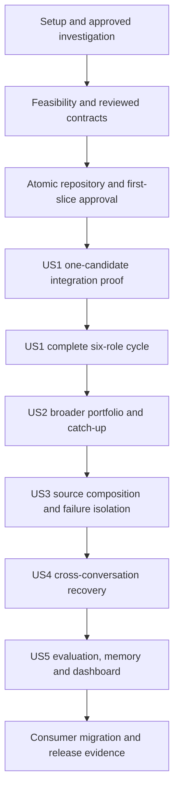

# Tasks and Completion Evidence

This is the sole work-status record. [Spec](spec.md) defines requirements;
[plan](plan.md) defines sequence; [checklist](checklist.md) assesses readiness.
Statuses: COMPLETE, IN_PROGRESS, NOT_STARTED, BLOCKED or DEFERRED. Approved
design is not evidence of implemented behavior.

## Current delivery

| ID | Task | Status | Scope and evidence |
| --- | --- | --- | --- |
| D0 | Consolidate approved redesign and repository documentation | COMPLETE | Ten English canonical documents, reference/checker migration, 24 legacy documents and two tracked task reports consolidated; local verification below |
| D0a | Clarify material product ambiguities and shorten project instructions | COMPLETE | Fifteen accepted clarifications recorded in spec across three five-question passes, completed on 2026-10-22. Canonical references and concise AGENTS.md reviewed; final local checks below passed. No further material product clarification is needed before planning. Technical research and all seven implementation-readiness gates remain open. |
| D0b | Update canonical technical plan and supporting contracts | COMPLETE | Documentation-only planning on `main` from `dcd0e2b`, verified on 2026-10-23; seven canonical documents updated, accepted decisions/current profile preserved, full offline suite and local checks passed; all seven implementation-readiness gates remain open |
| D0c | Decompose the accepted plan into executable tasks | COMPLETE | Documentation-only task generation on 2026-11-09 from `cb5f420`; five specification scenarios mapped to a dependency-ordered checklist with scoped gates and acceptance criteria; no implementation task executed |

D0 contains no production implementation. Existing source, schemas, runtime
skills, workflow, prompts, dependencies and package version must remain unchanged.
The user has confirmed D0; there is no additional documentation approval gate.

## Existing foundation

Presence of the code below establishes implementation inventory, not a new
current CI, installed-host, live-source or personal-graduation claim.

| Area | Implementation status | Evidence |
| --- | --- | --- |
| Provider-neutral model/tool/registry and bounded runtime | IMPLEMENTED | [agent exports](../src/finance_research_agent/agent/__init__.py), [runtime tests](../tests/agent/test_runtime.py) |
| Deterministic market/regime/setup/scoring/sizing and evidence validation | IMPLEMENTED | [domain models](../src/finance_research_agent/domain/models.py), [validation](../src/finance_research_agent/domain/validation.py), compatibility profile |
| Frozen preparation, storage/publication/replay and telemetry | IMPLEMENTED | [preparation](../src/finance_research_agent/application/premarket_preparation.py), [repository](../src/finance_research_agent/adapters/filesystem.py), [replay](../src/finance_research_agent/application/replay_service.py) |
| Typed local MCP operations and three bounded skills | IMPLEMENTED | [operations](../src/finance_research_agent/application/operations.py), [skill index](../skills/README.md) |
| Scenarios, failure evaluation, offline CI, doctor and release evidence machinery | IMPLEMENTED | [release gates](../src/finance_research_agent/evaluation/release_gates.py), [CI](../.github/workflows/ci.yml); baseline includes release-readiness merge `e5df43c` and CI fix `aa3fb0d` |
| Full-source research conformance | DEFERRED | Existing readiness model requires separately approved source scope |
| Actual Work integration, six-role loop, simulator, ledger and dashboard | NOT_STARTED | No production implementation established in D0 |
| Installed-host checks, live smoke and personal elapsed-day graduation | NOT_ESTABLISHED_HERE | Require their own verified/operator evidence; local checks do not substitute |

## Planned implementation

Production implementation remains NOT_STARTED. T03–T05 have design work in
progress through D0b; their review/fixture/feasibility exits are not complete.
Begin actual execution with reviewed bounded feasibility work; do not infer
authorization to implement the full plan from this task list.

| ID | Deliverable | Depends on | Requirements | Completion evidence |
| --- | --- | --- | --- | --- |
| T01 | Work host/transport/subagent and budget spike | D0; RQ-01, RQ-05 | FR-02, FR-03, FR-07, FR-11 | Actual synthetic host trace, structured return, bounded delegation and cross-conversation resume |
| T02 | Source/capability matrix and evidence spike | D0; RQ-02, RQ-05 | FR-01, FR-04, FR-07, FR-11 | Normalized samples, required-role matrix, licensing/availability/cost findings |
| T03 | Simulation, risk, ledger and pause contracts | D0; RQ-03 | FR-01, FR-02, FR-05–FR-08 | Reviewed transition/arithmetic examples, ambiguity/corporate-action/cash rules and idempotency design |
| T04 | Evaluation/baseline and cost policy | D0; RQ-04, RQ-05 | FR-09, FR-11 | Matched baseline definitions, metrics and observation/usage limitations |
| T05 | Versioned cycle/role/decision/portfolio interfaces and first-slice design | T01–T04 | FR-03–FR-07, FR-10–FR-12 | Reviewed schemas, authorization/preconditions, consumer migration and scoped implementation approval |
| T06 | One end-to-end vertical slice | T05 | FR-01, FR-02, FR-05–FR-09 | Known candidate → frozen evidence → Work proposal → risk → simulated order/fill → ledger → replay, including crash/duplicate rejection |
| T07 | Full analyst/challenger/decision loop | T06 | FR-03, FR-04, FR-07 | Six inspectable role outputs, shared context, one supplementary round, invalid/partial/unavailable paths |
| T08 | Portfolio lifecycle and local dashboard | T06; T03 | FR-01, FR-05–FR-08 | Multiple candidates/positions, stops and gaps, accounting/cash, pause/recovery, evidence-linked UI |
| T09 | As-of memory, reflection and evaluation | T07, T08; T04 | FR-09, FR-10 | No future leakage, immutable decisions/outcomes, exact replay and matched forward metrics |
| T10 | Consumer migration and release evidence | T07–T09 | FR-01–FR-12 | Brief/skill integration, compatibility decisions, installed host, replay corpus and forward evidence with explicit limitations |

Use focused tests and review at each task. Update these rows with exact changed
contracts, check results and evidence references as work occurs. Do not copy the
task list into new dated plans or turn research questions into unchecked assumptions.

| Work item | Current status | Planning contribution and remaining exit |
| --- | --- | --- |
| T01 | NOT_STARTED | Host/receipt/role probe designed; actual Work invocation, limits and resume observations absent |
| T02 | NOT_STARTED | Desk inventory/source matrix supplied; configured normalized samples, licenses and approvals absent |
| T03 | IN_PROGRESS | Proposed event/Decimal/ledger/state contracts and S01–S13 oracles; technical review, calendar/event evidence and executable fixtures pending |
| T04 | IN_PROGRESS | Proposed trading scorecard/benchmark/metric contracts and E01–E06 oracles; policy-version review and executable replay fixtures pending |
| T05 | IN_PROGRESS | Versioned semantic records/operations, storage/consumer strategy and proposed first-slice files; actual host binding, generated schemas, compatibility fixtures and slice approval pending |
| T06–T10 | NOT_STARTED | Dependent implementation/release work remains gated |

## Executable task breakdown

Generated on 2026-11-09 from the canonical design at `cb5f420`. This is a
bounded documentation update; it does not execute or authorize the checklist.
T01–T10 above remain milestone rollups referenced by the plan and research gates.
Three-digit T001 onward below identify the remaining executable work; none is
complete merely because related design text or legacy code already exists.

Inputs: [specification](spec.md), [plan](plan.md), [data model](data-model.md),
[target contracts](contracts.md#target-interface-boundary),
[research gates](research.md#remaining-gate-evidence), and
[validation scenarios](quickstart.md#planning-validation-and-future-slice-acceptance).
The repository constitution overrides the unfilled installed Spec Kit template.

### Execution rules and story mapping

The spec has five numbered user scenarios and no P1/P2/P3 ranking. US1–US5 map
one-to-one to those scenarios in their existing order; these labels do not add
product priorities. Phase dependencies follow the approved migration sequence.
Tests are included because FR-01–FR-10 explicitly require tested acceptance,
replay, recovery and accounting outcomes. Write each acceptance test before its
implementation and verify it detects the missing behavior; use offline fakes,
network guards and disposable persistence, then run it against the implementation.

Paths in task lines are repository-relative except the explicitly disposable
`/private/tmp/` probe. New source/test paths are proposed additions for scope
review, not claims of existing commands. Reuse the installed `.venv/bin` tools;
keep the package at `0.5.0.dev0` unless a release scope explicitly changes it.
An approved contract-only slice may add strict models/fixtures before the first
application slice; it cannot enable host operations or claim simulator readiness.
All seven current readiness items remain open after this task-generation pass.

Each task states direct prerequisites; transitive prerequisites also apply.
Tasks touching shared canonical documents are serialized. `[P]` means that after
the listed common prerequisite completes, the task can run alongside its named
siblings on different files; it does not mean prerequisites may be bypassed.
Parallel workers return evidence to one integrator for updates to this shared
status file. Every record/operation extension must update its generated schema
and consumer checks before activation, including later control/query operations.
Each later story requires its own bounded scope approval and relevant source,
calendar, policy and host evidence. A missing external prerequisite is recorded
as BLOCKED in this document; a new approved scope or source choice is required
before dependent work proceeds. Do not mark a broad checklist gate complete from
narrow synthetic evidence. Mark a task complete only with the observable result,
tests/evidence and scope disposition recorded here.

| Story | Specification scenario | Main requirements | Independent outcome |
| --- | --- | --- | --- |
| US1 | Configure and start an after-close decision cycle | FR-01–FR-06, FR-11 | Six attributed roles, valid next-session orders/no-trade and local validation |
| US2 | Reconcile prior orders/positions before later decisions | FR-01, FR-02, FR-05, FR-06, FR-08 | Daily and catch-up economic effects agree, including controls and supported events |
| US3 | Block a candidate with missing required evidence | FR-04, FR-05, FR-07, FR-11 | Precise affected-exposure block with independent work preserved |
| US4 | Resume after Work interruption | FR-02, FR-03, FR-07, FR-11 | Durable progress and effects survive a fresh conversation without reset/duplication |
| US5 | Inspect outcomes and approve later policy | FR-08–FR-11 | Auditable UI, reproducible evaluation, as-of memory and trusted later-effective approval |

### Phase 1: Setup and investigation scope

Goal: prepare a bounded investigation in the existing Python checkout, preserving the current research build. This phase does not initialize a second project. Exit: recorded scope, baseline and isolation controls; no readiness item is closed by setup alone.

- [ ] T001 Reconfirm the current commit, implemented API/schema inventory and T01–T10 status in `docs/tasks.md`; compare `src/finance_research_agent/application/operations.py`, `src/finance_research_agent/schema_export.py` and existing consumer tests with the preserved compatibility profile. (Depends on: none.)
- [ ] T002 Record approval of the bounded T01/T02 investigation and synthetic-fixture scope in `docs/tasks.md`, including allowed host invocation, temporary files, source samples, finite deadline/call/payload limits and separately opted-in live access; an absent approval blocks its dependent action. (Depends on: T001.)
- [ ] T003 Prepare the approved disposable harness at `/private/tmp/finance-research-trading-spike/host_probe.py` and record isolation in `docs/research.md`: owner-only empty dotenv, disposable data root, cleared provider credentials, network guard for local tests, no default-data writes or production tool registration. (Depends on: T002.)

### Phase 2: Foundational evidence, contracts and persistence

Goal: resolve RQ-01–RQ-05 for the bounded first slice and establish reviewed contracts and atomic storage. Entry: Phase 1 scope approval. The first three investigations share `docs/research.md`, so their recorded changes are serialized. Contract-only work has its own approval checkpoint before executable files are added. Exit: the first-slice gate below; failure of an external prerequisite blocks dependent work without fabricating evidence or substituting a paid runtime.

- [ ] T004 Run the approved synthetic Work probe in `/private/tmp/finance-research-trading-spike/host_probe.py`; record actual query, idempotent command, invalid/duplicate/lost-response, delegated-tool permissions, cancellation and fresh-conversation resume traces in `docs/research.md`, with actual or explicitly unavailable runtime metadata (RQ-01). (Depends on: T003.)
- [ ] T005 Complete the action/instrument source matrix in `docs/research.md`: common-stock and ETF needs, RAW opening/low/close eligibility, fundamentals, news/macro, corporate actions and separate settlement calendar; record configured access, sample hashes, availability/revision times, coverage, pagination, rate bounds, licenses/storage permission, quote date and scoped failures (RQ-02). (Depends on: T004.)
- [ ] T006 Record the complete incremental USD 100/month inventory and measured synthetic workload in `docs/research.md`, excluding the existing ChatGPT subscription but including upgrade delta/credits/data; separate observed, estimated and unknown shared usage, choose finite caps and demonstrate practical stop controls without purchasing anything (RQ-05). (Depends on: T005.)
- [ ] T007 Review the proposed numeric, conflict, calendar and persistence choices in `docs/contracts.md` and `docs/data-model.md`; record explicit risk/cost values, source/calendar evidence and accepted technical versions in `docs/research.md`, preserving all fifteen product clarifications and unresolved-event rules (RQ-03). (Depends on: T006.)
- [ ] T008 Review `trading-evaluation-v1`, benchmark selector/allocation, metric completeness and E01–E06 in `docs/contracts.md`; record reviewed metric/baseline versions, cost observability and replay expectations in `docs/research.md` without creating a profitability threshold (RQ-04). (Depends on: T007.)
- [ ] T009 Approve the bounded contract/model/fixture/repository file scope in `docs/tasks.md` before adding executable files; resolve the proposed `ports/trading.py` package against existing `application/ports.py`, freeze reason enums and schema names in `docs/contracts.md`, and retain legacy reader semantics without enabling trading operations. (Depends on: T008.)
- [ ] T010 [P] Create synthetic S01–S13 inputs/expected outcomes in `tests/fixtures/trading/simulation_oracles.json` and executable reference arithmetic/transition checks in `tests/contracts/test_trading_simulation_oracles.py`; cover exact/no stop touch, costs, holidays, fractions, event ambiguity and altered Decimal context without claiming a production simulator exists. (Depends on: T009.)
- [ ] T011 [P] Create E01–E06 plus missing/zero-denominator, no-trade and recovery-revision fixtures in `tests/fixtures/trading/evaluation_oracles.json` and reference checks in `tests/contracts/test_trading_evaluation_oracles.py`; freeze universe/dates/capital/cost/event inputs independently of agent proposals. (Depends on: T009.)
- [ ] T012 [P] Add boundary and reader fixtures in `tests/contracts/test_trading_records.py` for every mandatory field of the records introduced by T013–T014, unknown fields, UTC, hashes, strict enums, Decimal strings, missing values, unauthorized IDs and unsupported versions; retain original research fixtures. Store later role/event/evaluation cases as fixture data and activate their executable model checks in T033/T039/T070, so the first-slice gate does not depend on unimplemented later models. (Depends on: T009.)
- [ ] T013 Implement common envelope, PolicySnapshot, CandidatePoolSnapshot, CalendarSnapshot, TradingCycle, EvidenceSnapshot and CycleInputManifest in `src/finance_research_agent/domain/trading_models.py`; enforce “Content hashes exclude their own hash field”, “IDs are application-assigned; model-supplied IDs must resolve to authorized existing objects”, “strict unknown-field rejection and validated UTC timestamps”, “mutable caller containers cannot change frozen objects”, “Financial values are Decimal strings with units, never JSON floating-point values”, “New policy cannot reinterpret an accepted decision; absent required numeric values block use”, “XNYS sessions do not stand in for settlement dates; out-of-coverage dates are unavailable” and “All role outputs refer to one frozen manifest; revisions link parents without rewriting them”. (Depends on: T010; T011; T012.)
- [ ] T014 Add CommandReceipt, ReconciliationCursor, LedgerBatch, LedgerEntry, DecisionProposal, ValidationOutcome, SimulatedOrder/Fill, SettlementLot, ClosingObservation and PortfolioSnapshot with all documented mandatory fields in `src/finance_research_agent/domain/trading_models.py`; enforce “Same key and request returns original result; different payload conflicts; no effect without a durable receipt”, “A cursor advances only with its committed effects; unresolved state is not a completed session”, “One atomic commit; entry order and amounts reconstruct the projection without current configuration”, “Funding, buy/sell, settlement, split and dividend effects have distinct kinds; no synthetic balancing plug”, “Exactly one transfer; sale proceeds cannot be credited twice” and “One observation slot per scheduled close per evaluation revision, even without a cycle”. (Depends on: T013.)
- [ ] T015 Generate separately named first-slice trading schemas through `src/finance_research_agent/schema_export.py`; extend `tests/contracts/test_foundation_schema_export.py` and `tests/contracts/test_trading_records.py` to verify the frozen schema names, mandatory fields and unchanged legacy exports/reader bytes, without registering target operations. (Depends on: T014.)
- [ ] T016 Define the approved TradingRepository/data/calendar ports in `src/finance_research_agent/ports/trading.py` with package initialization in `src/finance_research_agent/ports/__init__.py`; specify bounded transactions, read snapshots, expected versions, receipt lookup and no provider types or SQL in domain/application consumers. (Depends on: T015.)
- [ ] T017 Add `tests/adapters/test_sqlite_trading.py` using disposable databases: event/receipt/projection atomicity, duplicate and conflicting requests, concurrent stale versions, rollback, crash boundaries, disk-full, bounded lock timeout, corrupt hashes and exact projection reconstruction. (Depends on: T016.)
- [ ] T018 Implement `src/finance_research_agent/adapters/sqlite_trading.py` against the approved port; store immutable canonical bytes/hashes and Decimal strings, commit receipts/events/versions/projections together, enforce foreign keys/full synchronization, check SQLite capabilities and preserve the existing filesystem research repository. (Depends on: T017.)
- [ ] T019 Record the scoped RQ-01–RQ-05 evidence, passing reference/schema/storage tests and explicit first-slice file/failure-case approval in `docs/tasks.md`; assess `docs/checklist.md` only against demonstrated closure criteria, leaving broader source/product gates open where evidence is incomplete. No US1 production work starts before this checkpoint. (Depends on: T018.)

### Phase 3: US1 — configure, research and accept next-session decisions

Source: specification scenario 1; FR-01–FR-06, FR-11. Goal: configure a known pool and approved policy, start after close in Work, inspect six role outputs and accept locally validated next-session orders or no-trade.

Independent test: from a disposable funded account and permitted frozen evidence, manually start Work after close; trace all six roles, one supplementary round at most, proposal and local validation. Reject unsupported instruments, missing policy and same-session execution; show the accepted next-opening instruction and linked report.

The early checkpoint in this phase is the plan's one-candidate T06 integration proof. It includes a stop, full cash/risk rejection, accounting and replay, but is explicitly incomplete until the later six-role tasks pass. Missing source coverage blocks exposure even in this slice; synthetic evidence stays labeled synthetic.

- [ ] T020 [P] [US1] Add `tests/domain/test_trading_vertical_slice.py` for positive one-time funding, long integer common-stock eligibility, no leverage, local sizing/exposure/stop-risk, full gap/cash rejection, S01–S06 cost/stop rules, closing equity and no guessed policy values. (Depends on: T019.)
- [ ] T021 [P] [US1] Add `tests/application/test_trading_commands.py` for trusted human start, closed command envelopes, expected versions, receipt-first retries, payload conflicts, query purity, invalid role submissions and bounded terminal/no-trade outcomes; add wire/schema consumer cases in `tests/contracts/test_trading_operations.py` before host activation. (Depends on: T019.)
- [ ] T022 [P] [US1] Add `tests/integration/test_trading_vertical_slice.py` with isolated fakes for one known candidate → frozen evidence → structured proposal → local risk → next-open fill/stop → ledger/closing report → network-free replay; include lost response and insufficient settled cash. (Depends on: T019.)
- [ ] T023 [US1] Implement `src/finance_research_agent/domain/trading_policy.py`: approved required policy, eligibility, whole-share quantity, conservative pending-order exposure, settled-cash and stop-risk caps, globally frozen action priority and conflict rejection; keep old research sizing/setup scores as evidence rather than universal vetoes. Add separate initial trading configuration loading in `src/finance_research_agent/adapters/yaml_config.py` with explicit capital/pool/policy approval and effective-version references; preserve legacy policy files/defaults and test invalid/missing configuration in `tests/contracts/test_trading_records.py`. (Depends on: T020; T021; T022.)
- [ ] T024 [US1] Implement the first-slice numeric/funding/buy/sell/cost/settlement/closing primitives in `src/finance_research_agent/domain/accounting.py`: reviewed Decimal context, cents/eight-place price, purchase-fee capitalization, residual cost on full exit, separate unsettled proceeds and no duplicate slippage/dividend postings; block unsupported events. (Depends on: T023.)
- [ ] T025 [US1] Implement first-slice intended-opening and daily-stop rules in `src/finance_research_agent/domain/simulation.py`: raw eligible evidence, full quantity or rejection, missing versus confirmed nonexecution, opening-stop priority, same-session entry protection and original-opening recovery; bind S01–S06 and S11 to the implementation. (Depends on: T024.)
- [ ] T026 [US1] Implement first-slice typed start/status/artifact/proposal/reconcile operations, their generated schemas through `src/finance_research_agent/schema_export.py`, and lifecycle coordination in `src/finance_research_agent/application/trading_operations.py` and `src/finance_research_agent/application/trading_service.py`; enforce trusted actor, finite budgets, frozen inputs, receipt-first retry and one active mutating cycle. Label the limited role path as an integration proof, never a completed six-role cycle. (Depends on: T025.)
- [ ] T027 [US1] Implement `src/finance_research_agent/application/trading_evidence.py` and the approved RAW path in `src/finance_research_agent/adapters/alpaca_historical.py`; keep adjusted research defaults unchanged, require normalized original-opening eligibility and complete frozen provenance, and use synthetic fixtures until source access is approved. (Depends on: T026.)
- [ ] T028 [US1] Integrate only the proven first-slice transport in `src/finance_research_agent/adapters/mcp_stdio.py` and `src/finance_research_agent/adapters/mcp_bootstrap.py`; bind permissions from the trusted channel, namespace reviewed target operations, reject arbitrary URLs/paths/code and preserve existing Product A discovery and startup behavior. (Depends on: T027.)
- [ ] T029 [US1] Add a simulated-lifecycle projection in `src/finance_research_agent/application/trading_report.py` with authoritative record links, accepted/rejected/no-trade outcomes and unavailable fields; never calculate a second ledger or relabel old PlanObservation records as fills. (Depends on: T028.)
- [ ] T030 [US1] Implement `src/finance_research_agent/application/trading_replay.py` over stored decisions, inputs, versions and ledger prefixes; reproduce economic effects without network/model/current-policy reads, preserve original bytes and distinguish processing timestamps from effective event ordering. (Depends on: T029.)
- [ ] T031 [US1] Run the one-candidate integration proof in `tests/integration/test_trading_vertical_slice.py` and the approved actual-host synthetic trace; record D2 evidence and remaining six-role/source limitations in `docs/tasks.md` before expanding to the rest of US1. (Depends on: T030.)
- [ ] T032 [US1] Add `tests/contracts/test_trading_roles.py` and `tests/application/test_trading_roles.py` for six assignments, shared context, typed claims, provenance/unavailability, challenger resolution, at most one supplement, post-cutoff revisions, invalid submissions and bounded exhaustion. (Depends on: T031.)
- [ ] T033 [US1] Add RoleAnalysis and Challenge and connect the existing DecisionProposal/ValidationOutcome in `src/finance_research_agent/domain/trading_models.py`, and coordination in `src/finance_research_agent/application/trading_roles.py`; preserve the required role/round/assignment/input-manifest/status/claim/evidence fields, COMPLETE/PARTIAL/UNAVAILABLE statuses, activate role-record checks in `tests/contracts/test_trading_records.py`, export reviewed schemas through `src/finance_research_agent/schema_export.py`, and enforce the rule “A model may report requested allocation; only local validation creates an accepted quantity, order or authoritative metric.” (Depends on: T032.)
- [ ] T034 [US1] Wire the reviewed six-role assignments through `src/finance_research_agent/application/trading_service.py` and `src/finance_research_agent/adapters/mcp_stdio.py`; enforce the target cycle transition table, one manifest per revision, explicit output reuse/revalidation and root-lineage budgets without fabricated role results. (Depends on: T033.)
- [ ] T035 [US1] Extend `tests/integration/test_trading_vertical_slice.py` to the complete six-role US1 trace, then record actual Work acceptance and unavailable sources in `docs/tasks.md`; demonstrate after-close start, next-session orders, valid no-trade, counter-evidence and a non-breakout/pullback thesis that still obeys all hard gates. (Depends on: T034.)

### Phase 4: US2 — reconcile positions and missed sessions

Source: scenario 2; FR-01, FR-02, FR-05, FR-06, FR-08. Entry: US1 and reviewed expansion to the supported instruments/events. Goal: reproduce chronological economic effects before the next decision, including common corporate actions and user controls.

Independent test: start from stored accepted instructions and identical raw evidence; compare daily processing with multi-session catch-up. Require equal fills, cash, cost and every scheduled closing equity; retain effective/processing times separately. Include T+1 holidays, stop-versus-sell ordering, replacement/pause boundaries, splits, dividend entitlement/payment and unresolved fractions without retrospective decisions.

- [ ] T036 [US2] Record the T08 expansion approval and instrument/event/calendar source coverage in `docs/tasks.md` and `docs/research.md`; review the exact changes to `src/finance_research_agent/domain/simulation.py` and `src/finance_research_agent/domain/accounting.py` before extending the first slice. (Depends on: T035.)
- [ ] T037 [P] [US2] Add `tests/domain/test_trading_corporate_actions.py` for S07/S08/S13, exact rational split-stop boundaries, split order/quantity/cost conservation, same-date entitlement-before-payment, unsupported terms and fractional remainders without discarded holdings. (Depends on: T036.)
- [ ] T038 [P] [US2] Add `tests/application/test_trading_reconciliation.py` for S09–S12, daily/catch-up equivalence, T+1 settlement holidays, pending changes, pause equality, global cross-batch priority, unavailable input dependencies and scheduled closes without agent activity. (Depends on: T036.)
- [ ] T039 [US2] Add CorporateAction, InstructionChange and DividendReceivable and integrate the existing SettlementLot/ClosingObservation in `src/finance_research_agent/domain/trading_models.py` with their mandatory field lists; activate event-record checks in `tests/contracts/test_trading_records.py` and schema export in `src/finance_research_agent/schema_export.py`; enforce “Separate verified terms from generated timestamps; unknown terms block affected adjustments”, “Failed change leaves original active; successful replacement/cancellation is atomic at its boundary”, “Exactly one transfer; sale proceeds cannot be credited twice”, “Entitlement creates income/receivable once; payment moves the same amount to settled cash” and “One observation slot per scheduled close per evaluation revision, even without a cycle”. (Depends on: T037; T038.)
- [ ] T040 [US2] Implement the reviewed settlement calendar in `src/finance_research_agent/adapters/settlement_calendar.py` and its normalization tests in `tests/adapters/test_settlement_calendar.py`; freeze coverage/holidays/version, keep trading sessions separate and reject missing/out-of-range dates instead of adding 24 hours. (Depends on: T039.)
- [ ] T041 [US2] Implement only the approved source normalization in `src/finance_research_agent/adapters/trading_corporate_actions.py` with offline samples in `tests/adapters/test_trading_corporate_actions.py`; retain stable identity, event revisions, verified split/dividend terms and occurrence/availability/retrieval times; unknown completeness must remain unavailable. (Depends on: T040.)
- [ ] T042 [US2] Extend `src/finance_research_agent/domain/accounting.py` for verified split adjustments and dividend receivable/payment transfers, exact stop ratios, separate income and closing components; bind S07/S08/S13 to production functions and retain immutable original fills/orders. (Depends on: T041.)
- [ ] T043 [US2] Extend `src/finance_research_agent/domain/simulation.py` through all contract phases and nontrading settlement/payment dates; respect economic dependencies, opening protection before sells before buys, residual daily-low protection, total priority across batches and instrument-scoped unresolved events. (Depends on: T042.)
- [ ] T044 [US2] Implement cancel/replace in `src/finance_research_agent/application/trading_service.py` and `src/finance_research_agent/application/trading_operations.py`; preserve the original on validation/activation failure, atomically switch both instructions, reject ordinary changes at/after opening and retain protection until its next eligible effective session. (Depends on: T043.)
- [ ] T045 [US2] Implement persisted human pause/resume in `src/finance_research_agent/application/trading_service.py`; cancel only pending buys whose opening is strictly later, reject new/increased exposure, retain research/reductions/protection/reconciliation, read historical pre-opening controls and never resurrect cancelled orders. (Depends on: T044.)
- [ ] T046 [US2] Implement cursor-driven catch-up and closing observation persistence in `src/finance_research_agent/application/trading_service.py`; enforce the full target instruction transition table, original-opening resolution, dependency blocks and every scheduled close without retroactive decisions or advancing past unresolved effects. (Depends on: T045.)
- [ ] T047 [US2] Extend `src/finance_research_agent/domain/trading_policy.py` and `src/finance_research_agent/application/trading_evidence.py` to approved common stocks and eligible ETFs, coherent whole-position protection, multiple positions and conservative portfolio-wide limits; retain action-specific source/freshness requirements. (Depends on: T046.)
- [ ] T048 [US2] Add `tests/integration/test_trading_catchup.py` for multiple held assets, pause/replacement, cash competition, ordinary corporate actions and daily/catch-up equality; verify all S01–S13 against production behavior and record US2 acceptance in `docs/tasks.md`. (Depends on: T047.)

### Phase 5: US3 — scope missing evidence and failures

Source: scenario 3; FR-04, FR-05, FR-07, FR-11. Entry: US2 and reviewed source-adapter scope. Goal: broaden source composition and prove precise failure isolation; this phase does not defer the fail-closed checks already required by US1/US2.

Independent test: with two candidates and an existing holding, remove required company evidence for one candidate. Its new exposure must be blocked while an independent complete candidate proceeds; existing exposure remains visible and protection runs only with valid inputs. Missing portfolio-critical state blocks aggregate risk/new exposure. Empty/unknown source results must never be labeled confirmed absence.

- [ ] T049 [US3] Record reviewed source-adapter field coverage, licensing and cost-fit expansion in `docs/research.md` and exact implementation scope in `docs/tasks.md`; stop dependent adapters when required access/terms remain unavailable rather than selecting a vendor implicitly. (Depends on: T048.)
- [ ] T050 [P] [US3] Add `tests/application/test_trading_failure_scope.py` for missing fundamentals, ETF structure, raw bars, stale/conflicting facts, post-cutoff evidence, critical ledger dependencies and unaffected-candidate continuation. (Depends on: T049.)
- [ ] T051 [P] [US3] Add `tests/security/test_trading_boundary.py` for external-text injection, arbitrary URL/path/tool requests, unauthorized IDs/actors, oversized submissions, secret-free errors and forbidden direct ledger writes; use offline guards and no real data. (Depends on: T049.)
- [ ] T052 [US3] Compose approved common-stock and ETF evidence through `src/finance_research_agent/application/trading_evidence.py` and reviewed normalization in `src/finance_research_agent/adapters/sec.py`; preserve periods/units/publication/revision provenance, and never treat filing metadata alone as financial analysis. An additional ETF adapter requires its own reviewed path in `docs/plan.md` before code. (Depends on: T050; T051.)
- [ ] T053 [US3] Compose the approved news/company-event/shared-macro adapters in `src/finance_research_agent/adapters/alpaca_news.py`, `src/finance_research_agent/adapters/company_ir.py` and `src/finance_research_agent/adapters/macro.py`; enforce frozen source policies, bounded retrieval and evidence-backed NO_EVENTS_CONFIRMED without widening legacy source defaults. (Depends on: T052.)
- [ ] T054 [US3] Implement action/instrument evidence coverage, claim validation and availability propagation in `src/finance_research_agent/application/trading_evidence.py`; distinguish judgments from deterministic fields, require supported entailment, link successor revisions and permit only independently valid protection/reductions. (Depends on: T053.)
- [ ] T055 [US3] Finish safe closed reasons and scoped recovery guidance in `src/finance_research_agent/application/trading_operations.py` and `src/finance_research_agent/application/trading_report.py`; persist rejection receipts, distinguish unavailable from zero and avoid raw exception text or fabricated account totals. (Depends on: T054.)
- [ ] T056 [US3] Enforce measured deadline/tool/retry/submission/delegation/payload limits and incremental-spend controls in `src/finance_research_agent/application/trading_roles.py`; preserve counters across restart/revision, block new spending work at observable limits and keep valid stored-input accounting/recovery available. (Depends on: T055.)
- [ ] T057 [US3] Add `tests/integration/test_trading_evidence_failures.py` for the independent-candidate scenario, global corruption, source conflict and exhaustion; record remaining source limitations and separate synthetic versus opted-in live evidence in `docs/tasks.md`. (Depends on: T056.)

### Phase 6: US4 — recover in a fresh Work conversation

Source: scenario 4; FR-02, FR-03, FR-07, FR-11. Entry: US3 and reviewed recovery scope. Goal: prove host-independent durable progress across interruption; basic atomicity/idempotency is already required in Phase 2/US1.

Independent test: interrupt before commit and after commit/before response, reopen the same disposable repository from a new Work conversation, retry the identical command, then attempt a changed payload and stale version. Require one set of effects, the original receipt, unchanged cutoff, remaining root-lineage budget and no model/network calls during stored-decision replay.

- [ ] T058 [US4] Record the crash/restore/actual-host recovery investigation scope in `docs/tasks.md`; use disposable accounts and approved host access, with no repair of personal state and no installation or transport deployment implied by this task list. (Depends on: T057.)
- [ ] T059 [P] [US4] Add `tests/integration/test_trading_crash_recovery.py` for pre/post-commit interruption, disk-full, concurrent stale commands, lost receipt response, corrupt artifacts/projections, version mismatch and restored backup equivalence. (Depends on: T058.)
- [ ] T060 [P] [US4] Add `tests/application/test_trading_resume.py` for all cycle terminal/blocked stages, interrupted transport, successor revision counter inheritance, validated role-output reuse, pause distinct from cycle cancellation and second-supplement rejection. (Depends on: T058.)
- [ ] T061 [US4] Complete startup integrity/rollback/projection rebuilding in `src/finance_research_agent/adapters/sqlite_trading.py`; fail dependent mutations on corrupt ledger bytes or unsupported versions, preserve authoritative history and never repair balances with synthetic entries. (Depends on: T059; T060.)
- [ ] T062 [US4] Implement durable `trading.resume_cycle` in `src/finance_research_agent/application/trading_service.py`; reconstruct permitted unfinished work from artifacts/receipts, preserve identities/completed effects, and enforce the documented BLOCKED/CANCELLED/DEADLINE_EXCEEDED/BUDGET_EXHAUSTED semantics without silently reopening terminal cycles. (Depends on: T061.)
- [ ] T063 [US4] Complete successor-cycle and role-lineage handling in `src/finance_research_agent/application/trading_roles.py`; enforce “Successor revisions share the root cycle's deadline, counters and consumed supplementary allowance; they cannot reset them” and require explicit reissue/revalidation or validated reuse links before proposal acceptance. (Depends on: T062.)
- [ ] T064 [US4] Complete `trading.get_capabilities`, `trading.get_status` and `trading.get_artifact` in `src/finance_research_agent/application/trading_operations.py`; bind access to trusted scope, stable snapshot pagination and immutable identities, exposing unavailable host metadata without hidden collection or reconciliation. (Depends on: T063.)
- [ ] T065 [US4] Implement consistent snapshot backup/restore in `src/finance_research_agent/adapters/sqlite_trading.py`, test original hashes and reconstructed state in `tests/adapters/test_sqlite_trading.py`, and document the verified recovery procedure in `docs/operations.md`. (Depends on: T064.)
- [ ] T066 [US4] Exercise the approved fresh-conversation Work recovery scenario from `docs/quickstart.md` and the completed `tests/integration/test_trading_crash_recovery.py`; record actual transport/permission/receipt traces separately from offline results in `docs/tasks.md`. (Depends on: T065.)

### Phase 7: US5 — inspect results, reflect and approve later policy

Source: scenario 5; FR-08–FR-11. Entry: US4 and reviewed evaluation/memory/UI slice. Goal: inspect authoritative evidence, decisions and account results, compare fair benchmarks, retrieve as-of memory, and explicitly approve policy for a later cycle.

Independent test: inspect one complete and one failed/recovered cycle in the local dashboard; follow every displayed number to stored inputs, reproduce E01–E06, retain missing dates and linked recovery revisions, exclude future memory and reject model/stale policy approvals. A trusted human change affects only a later cycle. Work starts separately; no dashboard-to-Work launch is presumed.

- [ ] T067 [US5] Record the reviewed evaluation/memory slice and remaining source/metric approvals in `docs/tasks.md` and `docs/contracts.md`; freeze the trading namespace and preserve research ShadowScorecard and MetricResult semantics. (Depends on: T066.)
- [ ] T068 [P] [US5] Add `tests/evaluation/test_trading_evaluation.py` for E01–E06, fees/slippage/turnover, fixed funding, same-date benchmark assumptions, unknown initial eligibility, missing closes, positive daily denominators and separately reproducible recovery revisions. (Depends on: T067.)
- [ ] T069 [P] [US5] Add `tests/application/test_trading_memory.py` for hypothesis/decision/outcome/reflection separation, cutoff-bound retrieval, future-outcome exclusion, immutable provenance and recommendations that cannot approve policy. (Depends on: T067.)
- [ ] T070 [US5] Implement EvaluationManifest, EvaluationRecord and namespaced trading MetricResult in `src/finance_research_agent/evaluation/trading_models.py`; include all mandatory fields, activate evaluation-record checks in `tests/contracts/test_trading_records.py` and enforce “Agent/cash/buy-hold share observation dates and assumptions; recovered data derives a new revision” and “Missing denominator/input is unavailable, never zero by default; results bind coverage and provenance”; export reviewed schemas through `src/finance_research_agent/schema_export.py`. (Depends on: T068; T069.)
- [ ] T071 [US5] Implement `src/finance_research_agent/evaluation/trading_benchmarks.py`: zero-interest cash and frozen equal cost-inclusive sleeves, whole shares, first-eligible-opening selection, retained cash and common cost/settlement/event rules; advance only confirmed ineligibility, never unknown evidence or later favorable returns. (Depends on: T070.)
- [ ] T072 [US5] Implement `src/finance_research_agent/evaluation/trading_metrics.py` against the approved availability matrix: cumulative/consecutive daily returns, initial-capital daily closing drawdown, turnover, costs, breaches/failures, evidence/valuation coverage and observable usage; distinguish empty denominators from missing required inputs and never carry forward prices. (Depends on: T071.)
- [ ] T073 [US5] Implement `src/finance_research_agent/application/trading_evaluation.py` and `trading.evaluate` in `src/finance_research_agent/application/trading_operations.py`; freeze schedules/manifests, compare compatible available results and append recovery revisions without rewriting decisions, prior metrics or original peaks. (Depends on: T072.)
- [ ] T074 [US5] Implement MemoryRecord and bounded as-of retrieval/reflection in `src/finance_research_agent/domain/trading_models.py` and `src/finance_research_agent/application/trading_memory.py`, exposing `trading.query_memory` through `src/finance_research_agent/application/trading_operations.py`; activate memory-record checks in `tests/application/test_trading_memory.py` and export its reviewed schema through `src/finance_research_agent/schema_export.py`; preserve “Hypothesis/decision/outcome/reflection kind, availability time, linked evidence/run/policy and counter-evidence; no implicit policy authority”. (Depends on: T073.)
- [ ] T075 [US5] Implement trusted human `trading.approve_policy` and pool/configuration writes in `src/finance_research_agent/application/trading_operations.py` and `src/finance_research_agent/application/trading_service.py`; reject stale versions and model-supplied actor claims, retain approval/effective boundaries and create a separate portfolio/evaluation for changed starting capital. (Depends on: T074.)
- [ ] T076 [US5] Select and review the local dashboard framework, transport, authentication and exact file/dependency scope in `docs/plan.md` and `docs/contracts.md`; compare alternatives against cost/local-only constraints. The following UI paths are proposed review targets, not an already selected stack; resolve any path changes here before implementation. (Depends on: T075.)
- [ ] T077 [US5] Add approved UI acceptance tests in `tests/integration/test_trading_dashboard.py`: one complete and one failure/recovery cycle, stale writes, human-only controls, simulated labels, authoritative number links, frozen/current distinction, unavailable metrics and no implied Work launch. (Depends on: T076.)
- [ ] T078 [US5] Implement read projections in `src/finance_research_agent/application/trading_dashboard.py`; serve pool/policy, evidence/roles, decisions/rejections, orders/fills, cash/positions/equity, evaluations/reflections and pause state from versioned stored records with bounded pagination and no financial recalculation. (Depends on: T077.)
- [ ] T079 [US5] Implement the approved local UI at `src/finance_research_agent/adapters/trading_dashboard.py` using the selected framework and reviewed assets; route human controls through trusted application operations, display pause effects and historical/unavailable states, and keep Work initiation separate. (Depends on: T078.)
- [ ] T080 [US5] Run `tests/integration/test_trading_dashboard.py` and actual local UI/operator checks, including all benchmark/recovery/memory cases; record implementation tests, observed UI behavior and missing evidence separately in `docs/tasks.md` without claiming profitability or installed Work behavior from rendering alone. (Depends on: T079.)

### Phase 8: Migration, hardening and release evidence

Goal: migrate consumers deliberately and close cross-cutting release obligations after the five stories pass. Each interface change retains its own review; source/host/policy or publication approval is never inferred from a green test. Exit: explicit release disposition with engineering, remote CI, operator and forward-performance evidence separated.

- [ ] T081 Record the per-consumer interface migration/retirement decision in `docs/contracts.md` and `docs/tasks.md` for briefs, eleven Product A operations, three skills, schemas and historical readers; preserve original artifact meanings/bytes and approve any break before changing consumers. (Depends on: T080.)
- [ ] T082 Add `tests/contracts/test_trading_compatibility.py` covering original research artifacts, unchanged old readers, new namespaced schemas, derived views and explicit unsupported-version handling; demonstrate old TradePlanDraft/PlanObservation never become orders/fills or realized P&L by relabeling. (Depends on: T081.)
- [ ] T083 Apply the reviewed migration in `src/finance_research_agent/application/report_renderer.py`, `skills/premarket-research/SKILL.md`, `skills/market-regime/SKILL.md`, `skills/watchlist-management/SKILL.md` and `skills/premarket-research/references/workflow-contract.yaml`; update only approved consumers and preserve compatibility fixtures and manual-start boundaries. (Depends on: T082.)
- [ ] T084 Complete cross-story security/failure verification in `tests/security/test_trading_boundary.py` and `tests/integration/test_trading_crash_recovery.py`: authorization, injection, path confinement, secret-free output, integrity, atomic replacements, finite retries and no arbitrary network/shell or real brokerage capability. (Depends on: T083.)
- [ ] T085 Update implemented commands, setup, recovery, versions and limitations in `docs/quickstart.md`, `docs/operations.md`, `README.md` and `skills/README.md`; preserve canonical ownership and remove target-only labels only where actual implementation and operator evidence justify it. (Depends on: T084.)
- [ ] T086 Run the complete offline suite, Ruff, mypy, docs/examples, generated schemas, secret scan, package/consumer checks and whitespace checks; record exact commit/results in `docs/tasks.md`, and keep `pyproject.toml`, `src/finance_research_agent/__init__.py` and current-version docs aligned if a separately approved release changes the version. (Depends on: T085.)
- [ ] T087 Execute the approved installed-host, local UI, backup/restore and source smoke procedures in `docs/operations.md`; record actual versions, fixture/input hashes and permission/receipt behavior in `docs/tasks.md`, with opted-in live observations separate from synthetic checks and no schedule/purchase activation. (Depends on: T086.)
- [ ] T088 Collect the approved forward paper-evaluation evidence with frozen policies and both matched baselines through `src/finance_research_agent/application/trading_evaluation.py`; preserve losing/no-trade periods and gaps, keep private records outside Git and record coverage/limitations in `docs/tasks.md` without inventing an elapsed-day or profit threshold. (Depends on: T087.)
- [ ] T089 Review FR-01–FR-12 traceability, open gates and the exact final diff in `docs/tasks.md` and `docs/checklist.md`; record COMPLETE/BLOCKED/DEFERRED accurately and request any still-required commit/push/release authorization separately from engineering acceptance. No real-money execution or deployment follows automatically. (Depends on: T088.)

### Dependencies, parallel work and MVP

The sequence is intentionally conservative because stories share the ledger,
cycle coordinator and operation boundary. Their acceptance scenarios are independently
runnable from frozen fixtures once prerequisites exist; they are not independent
storage implementations. Cross-story tests may use fixtures, but a fixture is not
evidence of actual Work access or permission. The dependencies on each checklist
line form the executable graph; there is no blanket permission to parallelize
stories or edit shared modules concurrently.

| Scope | Parallel example once ready | Join before implementation |
| --- | --- | --- |
| Foundation | After T009: T010 simulation oracles, T011 evaluation oracles, T012 schema/reader fixtures | T013 waits for all three |
| US1 | After T019: T020 domain tests, T021 command tests, T022 integration harness | T023 waits for all three |
| US2 | After T036: T037 corporate-action tests and T038 reconciliation/control tests | T039 waits for both |
| US3 | After T049: T050 evidence-isolation tests and T051 security tests | T052 waits for both |
| US4 | After T058: T059 crash tests and T060 resume tests | T061 waits for both |
| US5 | After T067: T068 evaluation tests and T069 memory tests | T070 waits for both |

Milestone rollup (original IDs remain stable):

| Existing milestone | Detailed task ownership |
| --- | --- |
| T01 | T002–T004, T006; actual-host follow-through T028, T066 |
| T02 | T005, T006; scoped source expansion T036, T040–T041, T049–T053 |
| T03 | T007, T010, T014; executable simulation/controls T024–T025 and US2 |
| T04 | T008, T011, T006; trading evaluation T067–T073 |
| T05 | T009–T019; role/schema extensions T032–T033 and T070 |
| T06 | T020–T031 |
| T07 | T032–T035 plus US3 evidence composition and failure proof |
| T08 | US2 and T076–T080 |
| T09 | T068–T075; full recovery T059–T066 |
| T10 | T081–T089 |

Requirement-to-task traceability supplements the milestone rollup:

| Requirement | Detailed coverage |
| --- | --- |
| FR-01 Instruments and portfolio | T013–T014, T020–T025, T039–T048, T070–T075 |
| FR-02 Cadence and bounded cycles | T004, T006, T021–T026, T034–T035, T038–T046, T060–T066 |
| FR-03 Six roles | T004, T032–T035, T056, T060–T063 |
| FR-04 Evidence and judgment | T005, T013, T027, T032–T035, T049–T057 |
| FR-05 Decisions and risk | T007, T020–T026, T033–T035, T044–T047, T054–T055 |
| FR-06 Execution and accounting | T007, T010, T014, T020–T031, T037–T048, T059–T066 |
| FR-07 Failure and recovery | T017–T018, T021–T022, T026, T038, T049–T066, T084 |
| FR-08 Dashboard and controls | T038, T044–T046, T075–T080 |
| FR-09 Evaluation | T008, T011, T030, T039, T046, T067–T073, T080, T088 |
| FR-10 Memory and reflection | T069, T074–T075, T078–T080 |
| FR-11 Runtime and cost | T002–T006, T019, T028, T034–T035, T056, T064–T066, T072, T087 |
| FR-12 Migration and documentation | T001, T009, T012–T015, T019, T081–T089 |

Suggested first delivery: complete the approved feasibility/contract prerequisites,
then T020–T031 for one common stock and a complete
funding/proposal/risk/fill/stop/cash/close/report/replay path. Stop and review its
D2 evidence before T032. This is a technical integration MVP, not complete
US1 or a release; six roles finish at T035 and first-release coverage
requires US2–US5 and the release phase. Do not shorten the MVP by dropping cash,
protective stops, idempotency, unavailable inputs or frozen provenance.

For each approved increment, run focused behavioral tests plus repository checks,
record results here, and review its diff before any separately authorized
publication. Full implementation/release review requires the complete offline
pytest suite, Ruff, mypy, docs/examples, schema drift, secret and whitespace checks
from [quickstart](quickstart.md#offline-checks). Installed-host/source/UI observations,
remote CI and elapsed forward evidence each require their own actual results.

## Documentation delivery verification

Verified for D0 on 2026-10-16 using Python 3.13.7:

| Check | Result |
| --- | --- |
| Full pytest suite with `FINANCE_RESEARCH_AGENT_OFFLINE_TESTS=1` and the repository network guard | 2,955 passed, 1 live test deselected; one existing `websockets.legacy` deprecation warning |
| `ruff check .` | PASS |
| `mypy src` | PASS; 104 source files |
| Generated-schema drift check | PASS |
| Documentation, internal links, canonical inventory, skills and example checks | PASS |
| Tracked secret scan | PASS; no new potential secrets |
| Ruff formatting of the three changed Python documentation-check files | PASS |
| Final staged diff and whitespace check | PASS; no production source, schema, runtime skill, prompt, dependency or version changes |

The full test run completed after the interactive wait was interrupted. Its
successful completion record was recovered on resume; tracked implementation
and test files were unchanged. Final documentation evidence was then refreshed.
The checker now rejects competing Markdown documents under `docs/` and checks
the saved-task prompt separately from unrelated operational documentation.

These results establish local documentation-delivery verification. They do not
establish remote CI, installed Work integration, live-source smoke, simulated
trading, or personal shadow graduation. The user authorized a local commit;
remote publication and subsequent implementation are outside D0.

D0a clarification verification on 2026-10-19: 58 documentation/workflow pytest
tests passed under the offline network guard; Ruff, mypy (104 source files),
schema export, documentation/link checks and whitespace checks passed. This pass
did not rerun the full suite or establish remote CI, installed-host, live-source
or simulated-trading evidence. The six changed tracked files are documentation
only; the pre-existing untracked Spec Kit installation is untouched.

The first pass asked and answered five questions, with five clarification records
and only the permitted new spec headings. The canonical checklist remains 16/23
checked, with no newly passing items or regressions; all seven implementation
readiness gates remain open. No clarification extension hooks are configured.

The first pass is complete. The user requested a second pass on 2026-10-19,
covering remaining simulation behavior followed by evaluation policy. Its first
two answers, accepted on 2026-10-20, define daily-data stops and single-opening,
full-quantity ordinary orders in FR-06, including unresolved historical data.
Its third answer, accepted on 2026-10-21, adds ordinary split/cash-dividend
accounting with raw execution/valuation prices and unresolved-event handling.
Its fourth answer, accepted on 2026-10-21, selects cash and equal-weight
buy-and-hold benchmarks, with a separate trading-strategy benchmark deferred.
Its fifth answer, accepted on 2026-10-21, preserves missing valuation dates and
coverage, makes availability depend on each metric's required inputs, and creates
a new evaluation revision when data is recovered. This completes the second
five-question pass; ten distinct answers are recorded across both passes.
At the end of the second pass, remaining [simulation](research.md#rq-03-simulation-semantics)
and [evaluation](research.md#rq-04-evaluation-policy) decisions included simultaneous
ordinary exit/stop ordering, cancellation/replacement behavior, cost-basis and
valuation conventions, and evaluation formulas/observation intervals. These could
change fills or reported results, so the conditional local commit was withheld
at that stage. The third pass below addresses those remaining product choices.

Second-pass verification on 2026-10-21: all 58 documentation/workflow pytest
tests passed under the offline network guard. Ruff, mypy (104 source files),
schema export, documentation/link checks and whitespace checks passed. Final
diff review confirmed six tracked Markdown files changed, with no production,
schema, dependency or version changes. Structural checks confirmed ten unique
clarification records, five per invoked pass, and only the permitted new spec
headings. The canonical checklist remains 16/23 checked, with no newly passing
items or regressions; all seven implementation-readiness gates remain open.
No clarification extension hooks are configured. The full suite was not rerun;
these checks establish no remote CI, installed-host, live-source or simulated-
trading evidence.

The user requested a third pass on 2026-10-21, focused on the remaining execution,
accounting and evaluation definitions before planning. Its first answer, accepted
on 2026-10-22, gives an opening-triggered protective stop priority over an
overlapping ordinary sell, with one full-position stop fill and a superseded
ordinary order. A stop triggered only later by the daily low applies to shares
remaining after opening sells. FR-06, the data model and RQ-03 are aligned.
Its second answer, accepted on 2026-10-22, keeps the original instruction active
when replacement validation fails and applies a successful replacement together
with the original's cancellation. Ordinary changes must precede the intended
opening; protective-stop changes preserve protection until their future effective
session. Explicit cancel-only requests retain timing and safety checks. FR-06,
the data model and RQ-03 are aligned.
Its third answer, accepted on 2026-10-22, selects weighted-average position cost,
including purchase fees in acquisition cost and deducting sale fees from proceeds,
with no duplicate slippage deduction and separate ordinary-dividend income.
FR-06 includes the approved arithmetic example; the data model and RQ-03 are
aligned.
Its fourth answer, accepted on 2026-10-22, selects every regular session's closing
valuation, including sessions without agent activity and catch-up. Equity includes
settled cash, unsettled sale proceeds, outstanding dividend receivables and shares
marked at unadjusted closing prices; unrealized trading results deduct remaining
acquisition cost. FR-06/FR-09, the data model and research references are aligned,
with identical benchmark observation dates and an explicit daily closing drawdown
label.
Its fifth answer, accepted on 2026-10-22, fixes each evaluation's initial funding,
excludes later external deposits/withdrawals, and defines cumulative/daily returns
and maximum daily closing drawdown. A capital change starts an independent
portfolio/evaluation while data recovery creates a linked revision of the existing
evaluation. FR-01/FR-09, the data model and RQ-04 are aligned. All five questions
in this pass are answered.

Final D0a review and verification on 2026-10-22: 58 documentation/workflow pytest
tests passed under the offline network guard; Ruff, mypy (104 source files),
schema export, documentation/link checks, whitespace checks and the tracked-file
secret scan passed. Arithmetic spot-checks confirmed the weighted-average example
and the initial-capital return/drawdown definitions. Structural checks confirmed
15 unique clarification records, five per invoked pass, and only permitted new
spec headings. The final diff contains six tracked Markdown files; production
code, tests, schemas, dependencies, runtime skills and package version are unchanged.
The pre-existing untracked Spec Kit installation is excluded from this delivery.

The consistency review scoped the old same-session-fill prohibition to ordinary
orders, preserving the approved same-day protective stop, and made approved split
adjustments explicit in execution quantities. No further material product question
blocks planning. Detailed event schedules, numerical precision/rounding, versioned
contracts and fixtures, auxiliary scorecard metrics, and actual host/source/budget
evidence remain in T01–T05 and RQ-01–RQ-05. These are technical design and readiness
work; this clarification completion does not close those gates.

The canonical checklist remains 16/23 checked, with no newly passing items or
regressions; all seven implementation-readiness items remain open. No clarification
extension hooks are configured. The full test suite was not rerun in D0a; local
documentation checks establish no remote CI, installed-host, live-source or
simulated-trading evidence. The user's conditional authorization now permits the
local documentation commit. Remote publication and production implementation
remain outside this delivery. Next workflow: speckit-plan, updating canonical
documents in place while preserving the accepted product choices.

## D0b technical planning evidence

Planning started on 2026-10-22 and final verification resumed on 2026-10-23,
on `main` at base `dcd0e2b`. Seven canonical documents were updated in place:
plan, research, data model, contracts, quickstart, checklist and this status
record. The accepted specification and its fifteen clarification records are
unchanged, as is the complete current implementation compatibility profile.

The design now specifies target command/record versions, trusted authorization,
transactional receipts and storage, lifecycle/event ordering, Decimal/accounting
rules, distinct settlement calendars, raw-price execution evidence, benchmark
allocation and metric availability. Nineteen scenario oracles (S01–S13, E01–E06)
define expected behavior without claiming implemented simulator tests. Proposed
file boundaries, alternatives and remaining evidence map to T01–T10.

Three read-only research agents covered simulation/accounting, evaluation and
host/source/cost constraints. Their consistency findings were addressed: recovered
stop supersession, total cross-batch order priority, historical pause-at-opening
semantics, same-date entitlement/payment dependency, first-eligible benchmark
selection, comparison dimensions, and budget/role lineage across revisions.
Final local review checked those changes against the unchanged specification.

| Local check | Result |
| --- | --- |
| Full pytest suite under the offline network guard | PASS; 2,955 passed, 1 live test deselected, one existing `websockets.legacy` deprecation warning; completed in 1,429.34 seconds on Python 3.13.7 |
| `ruff check .` | PASS |
| `mypy src` | PASS; 104 source files |
| Documentation/example/internal-link check | PASS |
| Generated-schema drift check | PASS |
| Tracked-file secret scan | PASS; no new potential secrets |
| Arithmetic spot-checks | PASS; weighted cost/fees, residual cents, returns/drawdown, benchmark cash/cost, dividend and split conservation |
| Preservation and whitespace checks | PASS; spec and legacy profile unchanged, ten canonical documents, 15 clarification records, 16/23 checklist, seven Markdown-only changes |

The earlier interrupted-session pytest result was unavailable on resume; the
full suite was rerun to completion, and the result above belongs to that fresh
run. A temporary local log retained the completion evidence; no test code or
behavior was changed to obtain the result.

The stock `setup-plan.sh --json` reported missing feature-directory state.
Read-only path resolution mapped FEATURE_SPEC, IMPL_PLAN and FEATURE_DIR to
`docs/spec.md`, `docs/plan.md` and `docs/`; the existing Git branch is `main`.
The repository constitution takes precedence over the unfilled installed template
and generic feature-folder/contracts-directory convention. No feature-state file
or parallel document was created. Pre/post hook checks found no
`.specify/extensions.yml`; no extension hooks were dispatched. The pre-existing
untracked Spec Kit installation remains outside the delivery.

All seven implementation-readiness items remain open. T03–T05 have design
progress, while actual Work traces, approved source/license/calendar coverage,
account-specific cost/workload evidence, reviewed executable contracts/fixtures
and first-slice approval remain outstanding. Required numerical account-policy
values were not guessed. These results establish no remote CI, installed-host,
live-source or forward-trading evidence. No production code, schema, dependency,
runtime skill or version changed. The initial D0b planning delivery ended before
publication. The user's subsequent request authorizes final review, commit and
push of the planning update; implementation and deployment remain outside scope.

Final publication review resumed on 2026-11-06. Independent read-only standards
and specification reviews reported no actionable findings against `dcd0e2b`.
Fresh preservation checks confirmed the accepted spec and legacy contract
profile are byte-for-byte unchanged, with seven Markdown files in the planning
diff and all seven readiness gates still open. Refreshed checks passed: 58
documentation/workflow tests, Ruff, mypy (104 source files), examples/internal
links, schema drift, tracked secrets, and whitespace. The three Python files
changed by the preceding documentation consolidation also pass format checking.
The complete offline suite was rerun on 2026-11-06: 2,955 passed, one live test
deselected and one existing `websockets.legacy` deprecation warning, in 1,481.57
seconds on Python 3.13.7. Representative arithmetic oracles also passed again.
Remote inspection found `main` at `aa3fb0d`; normal publication includes the
existing `d4915fb`, `f15438c` and `dcd0e2b` ancestors. Publication is verified
separately by the pushed commit and remote branch identity; local checks do not
establish remote CI or operator evidence.

## D0c task-generation evidence

Generated on 2026-11-09 from `cb5f420` using the requested `speckit-tasks`
workflow. Only this canonical task document changed. The five numbered user
scenarios map to US1–US5 without inventing P1/P2/P3 product priorities. Existing
T01–T10 milestone references and all earlier completion evidence are preserved.

The checklist contains 89 unchecked tasks: setup 3, foundation 16, US1 16, US2 13,
US3 9, US4 9, US5 14, and migration/release 9. Fourteen tasks form six explicit
parallel groups with distinct file ownership after their prerequisites. Every
line has a sequential ID, appropriate story label, exact file path and direct
prerequisites. Structural validation passed for all IDs/references, forward-only
acyclic dependencies, parallel-file separation, five independent acceptance
scenarios, FR-01–FR-12 coverage and 24 verbatim data-model constraint quotations.
The one-candidate T020–T031 integration proof is distinguished from full US1
completion at T035 and the later full-product/release obligations.

The stock `setup-tasks.sh --json` failed because this repository intentionally
has no feature-directory state. Read-only `get_feature_paths --no-persist` mapped
the workflow to `docs/`; template resolution loaded
`.specify/templates/tasks-template.md`. The canonical `docs/constitution.md`
overrides the unfilled installed constitution and generic feature-directory
layout; `docs/contracts.md` supplies the interface input instead of `contracts/`.
No feature-state file or second task document was created. Pre/post checks found
no `.specify/extensions.yml`, so no extension hooks were dispatched.

Fresh local checks passed: 58 documentation/workflow tests under the offline
network guard, Ruff, mypy (104 source files), docs/examples/internal links,
generated-schema drift, tracked secrets and whitespace. Preservation checks
confirmed ten canonical documents, unchanged accepted spec/plan/contracts and
16/23 readiness items checked. The full 2,955-test result above remains the
2026-11-06 evidence; the full suite was not rerun for this task-document-only
change. Task generation performed no implementation task, installed-host/source
probe, purchase or deployment. It ended before publication; the user's subsequent
request authorizes committing and pushing this task-document update. Publication
and remote CI results are verified separately from the local checks above.
